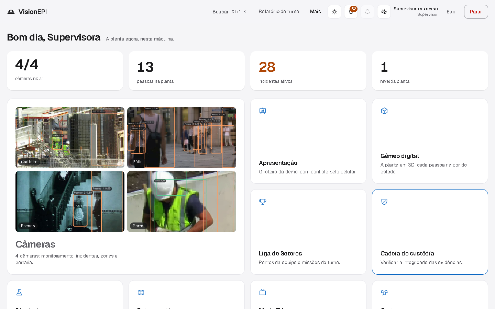
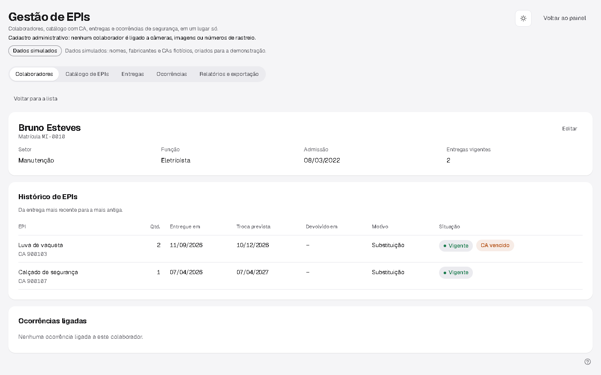

# VisionEPI

**Gestão de EPIs e segurança industrial para a Metaindústria: câmeras comuns que enxergam EPI, queda e área de
risco ao vivo, e a ficha de EPI digital no mesmo sistema. Por setor, nunca por pessoa.**

FIAP · Engenharia de Software · Turma **3ECR** · Sprint 4 (entrega final, 23/10/2026) · Prof. Hercules Lima Ramos.
Projeto do Challenge 2026 Metaindústria (FIAP × SPI Integração), apresentado na final do FIAP NEXT 2026.

| | |
|---|---|
| Protótipo | primeira versão versionada: [commit `e1e483a` (19/07/2026)](https://github.com/bolla-X/Challenge_5550/tree/e1e483a) · deck do pitch: [docs/pitch/VisionEPI-pitch-v3.pdf](docs/pitch/VisionEPI-pitch-v3.pdf) |
| Trello (público) | https://trello.com/b/zVZW2n1p/visionepi-challenge-3ecr |
| Vídeo (até 5 min) | LINK_DO_VIDEO_YOUTUBE |
| Manual de uso | [docs/manual-de-uso.md](docs/manual-de-uso.md) |
| Arquitetura | [docs/arquitetura.md](docs/arquitetura.md) · ADRs em [docs/adr/](docs/adr/README.md) |
| Requisitos e rastreabilidade | [docs/requisitos.md](docs/requisitos.md) |
| Scrum | [docs/scrum/](docs/scrum/README.md) (backlog, sprints 1–4, reviews, retros, DoD, [ata da review final](docs/scrum/ata-review-final-sprint4.md)) |
| Evolução das sprints | [docs/evolucao-sprints.md](docs/evolucao-sprints.md) |

<p align="center">
  
  
</p>

## O problema da Metaindústria

A segurança do trabalho na planta é **reativa**: inspeção periódica, checklist manual e punição depois do
incidente. A ficha de EPI fica no papel, então entrega sem histórico, troca vencida e Certificado de Aprovação (CA)
vencido passam despercebidos. E a ocorrência é registrada depois do fato, sem ligação com o que as câmeras já
mostravam.

## Proposta de solução

O VisionEPI junta as duas pontas num sistema só, que roda num notebook e sem internet:

1. **Visão computacional ao vivo** sobre câmeras comuns (RTSP, USB ou gravação): EPI por pessoa (detectado, visto
   sem, não verificável), queda, postura e área de risco, com alertas que viram **incidentes** agrupados e
   evidência com **cadeia de custódia**. Ninguém é identificado: rosto desfocado, sem reconhecimento facial, IDs
   de rastreio em vez de nomes.
2. **Gestão de EPIs** (cadastro administrativo, separado da visão): colaboradores com o **histórico de EPIs**,
   catálogo com **CA e validade**, registro de **entregas e devoluções** (a ficha de EPI da NR-6, item 6.5.1 d),
   **ocorrências** com ação corretiva e **exportação CSV**.
3. Uma **segunda opinião** de LLM multimodal (Gemini), fora do caminho do vídeo, que informa e nunca cria alerta;
   sem chave, ela aparece rotulada como **modo demonstração**.

Detalhe da arquitetura, com diagramas: [docs/arquitetura.md](docs/arquitetura.md).

## Funcionalidades (fluxos principais)

| Fluxo | Onde | Teste ponta a ponta |
|---|---|---|
| Dashboard: Início da supervisora, Visão geral por setor, Modo TV | `/`, botão "Visão geral" | `e2e/test_es_sprint4.py::test_dashboard_inicio_mostra_resumo_da_gestao` |
| Monitoramento em tempo real: grade de câmeras e foco com vídeo analisado | "Câmeras" → "Configurar <câmera>" | `test_monitoramento_em_tempo_real_video_chega_ao_canvas` |
| Alertas e incidentes (com segunda opinião em modo demonstração) | foco da câmera → abas "Alertas" e "Segunda opinião" | `test_alertas_nascem_da_deteccao_e_aparecem_como_incidente`, `test_segunda_opiniao_sem_chave_e_rotulada_modo_demonstracao` |
| Colaboradores com histórico de EPIs | `/gestao` → Colaboradores | `test_colaborador_tem_historico_de_epis` |
| Catálogo de EPIs com CA e validade | `/gestao` → Catálogo de EPIs | `test_catalogo_mostra_ca_e_situacao_da_validade` |
| Entregas e devoluções (entrega com CA vencido é bloqueada) | `/gestao` → Entregas | `test_entrega_com_ca_vencido_e_bloqueada_e_valida_e_registrada`, `test_formulario_de_entrega_explica_o_bloqueio_de_ca_vencido` |
| Ocorrências de segurança | `/gestao` → Ocorrências | `test_ocorrencia_registrada_aparece_na_lista` |
| Relatório e exportação (CSV e relatório mensal para a CIPA) | `/gestao` → Relatórios e exportação; `/relatorio/mensal` | `test_exportacao_csv_e_relatorio_mensal` |
| Tema claro e escuro | botão de tema na barra superior | `test_gestao_no_tema_escuro` |

Além disso, do FIAP NEXT 2026: gêmeo digital 3D, Portal de Entrada, Modo Apresentação, integração OPC UA/MQTT,
evacuação, permissão de trabalho, editor de regras, simulador, auditoria da cadeia de custódia. Lista completa e
números em [docs/referencia-tecnica.md](docs/referencia-tecnica.md) e [docs/NEXT2026/](docs/NEXT2026/).

## Instalação

Pré-requisitos: **Python 3.11 ou 3.12** (não 3.13+: `mediapipe` e `numpy` fixados não têm wheel), **Node.js 18 ou mais
novo** com npm (testado com o 24), **git** e internet só nesta etapa. Tempo medido no clone limpo: ver [Teste do avaliador](#teste-do-avaliador).

### Windows (PowerShell)

```powershell
git clone https://github.com/bolla-X/Challenge_5550.git
```

```powershell
cd Challenge_5550
```

```powershell
py -3.11 -m venv .venv
```

```powershell
.venv\Scripts\python -m pip install -r requirements.txt
```

```powershell
npm --prefix frontend ci
```

```powershell
npm --prefix frontend run build
```

```powershell
.venv\Scripts\python scripts\preparar.py
```

### macOS e Linux (bash) — não testado em macOS/Linux nesta entrega

```bash
git clone https://github.com/bolla-X/Challenge_5550.git
```

```bash
cd Challenge_5550
```

```bash
python3.11 -m venv .venv
```

```bash
.venv/bin/python -m pip install -r requirements.txt
```

```bash
npm --prefix frontend ci
```

```bash
npm --prefix frontend run build
```

```bash
.venv/bin/python scripts/preparar.py
```

O `scripts/preparar.py` baixa os três pesos dos modelos (conferindo o SHA-256), as gravações de demonstração
(Wikimedia Commons, licenças em [docs/FIXTURES.md](docs/FIXTURES.md)), exporta e aprova os runtimes rápidos e
aquece o cache. É a única etapa que precisa de internet e a mais demorada.

## Uso — modo demonstração

Não precisa de câmera IP, de webcam nem de chave de API, e não lê o seu `.env`.

```powershell
.venv\Scripts\python run.py --demo
```

(macOS/Linux: `.venv/bin/python run.py --demo`.)

1. Espere o terminal imprimir as três contas, `supervisor@demo.local`, `tecnico@demo.local` e
   `operador@demo.local`, cada uma com a senha gerada **nesta** execução (não vai para arquivo nem log).
2. Abra http://127.0.0.1:5000 e entre como **supervisor**. A primeira análise das câmeras leva cerca de 1 min.
3. Siga o [manual de uso](docs/manual-de-uso.md): Início → Câmeras → foco → Alertas → Gestão de EPIs.

O que a demo traz:

- **Banco isolado** (`instance/demo/demo.db`), recriado a cada `--demo`;
- **quatro câmeras** a partir de gravações públicas, rotuladas "GRAVAÇÃO". A webcam, se existir, vira o Portal ao
  vivo; sem webcam, o Portal toca uma gravação. Se as gravações não tiverem sido baixadas, as câmeras tocam a
  **amostra versionada** [`amostras/canteiro_amostra.mp4`](amostras/LICENCA.md) (7 s, CC BY-SA 4.0);
- **dados simulados da Metaindústria**: 24 colaboradores, 10 EPIs com CA (fictícios, faixa 9xxxxx), 60 entregas,
  15 ocorrências e 40 alertas históricos já resolvidos. As telas mostram o selo "Dados simulados";
- **segunda opinião em modo demonstração**: sem `GEMINI_API_KEY`, resposta fixa e rotulada, com confiança 0 e sem
  análise da imagem. Com a chave no ambiente do terminal (`$env:GEMINI_API_KEY="..."` antes do `run.py`), vale o
  Gemini real, e então o quadro de cada alerta novo é enviado ao Google. No modo demonstração o arquivo `.env` não
  é lido. A resposta aparece na tela de foco da câmera, em **Mais → Segunda opinião**.

Comandos úteis:

```powershell
.venv\Scripts\python -m flask --app wsgi demo reset
```

Rode em **outro** terminal, com a demo no ar. Zera os alertas, incidentes e evidências da demo em menos de 10 s,
sem derrubar o servidor; os 40 alertas históricos simulados são recriados pelo seed.

```powershell
.venv\Scripts\python -m flask --app wsgi gestao semear
```

Seed **idempotente** dos dados da Gestão de EPIs. A demo já roda o seed sozinha. Fora da demo o comando recusa
rodar sem a flag `--dados-ficticios`, porque grava colaboradores, CAs e 40 alertas **fictícios** no banco
configurado. Rodar duas vezes não duplica nada.

Porta ocupada: defina `$env:PORT="5001"` (bash: `PORT=5001`) antes do `run.py --demo`. Uso fora da demo (banco
próprio, `.env`, criação de contas, câmeras reais): [docs/referencia-tecnica.md](docs/referencia-tecnica.md).

## Testes

```powershell
.venv\Scripts\python -m pytest -q
```

```powershell
.venv\Scripts\python -m ruff check .
```

```powershell
.venv\Scripts\python -m playwright install chromium
```

```powershell
.venv\Scripts\python -m pytest e2e/test_es_sprint4.py -q
```

O último sobe a demo e percorre cada fluxo principal num Chromium real (`e2e/test_es_sprint4.py`). O frontend não
tem ESLint: a checagem de tipos é o `tsc -b` do `npm --prefix frontend run build`. A suíte E2E completa do NEXT 2026
fica em `e2e/` (detalhe em [docs/NEXT2026/QA.md](docs/NEXT2026/QA.md)).

## Teste do avaliador

Feito em 23/10/2026: clone limpo num diretório temporário, seguindo **só** os comandos da seção
[Instalação — Windows](#windows-powershell), num notebook Windows 11 com Python 3.11.9 e Node 24.19.0, com internet.

| Passo | Tempo medido |
|---|---|
| `git clone` | 6,5 s |
| `py -3.11 -m venv .venv` | 25,2 s |
| `pip install -r requirements.txt` | 619,3 s |
| `npm --prefix frontend ci` | 67,6 s |
| `npm --prefix frontend run build` | 28,0 s |
| `scripts\preparar.py` (pesos, gravações, runtimes, cache) | 546,4 s |
| **Total da instalação** | **1293 s ≈ 21 min 33 s** |

Depois, `run.py --demo` desse clone subiu em 19 s até imprimir as contas, e o Playwright desta entrega
(`e2e/test_es_sprint4.py`, 26 testes) passou inteiro contra ele (**26 passed**), assim como a fumaça do NEXT
(`e2e/fumaca_demo.py`, **6/6**). Uma parte do `pip install` rodou com outra suíte de testes ocupando a mesma
máquina, então o tempo é um teto, não uma média. macOS e Linux: **não testado** nesta entrega.

Durante o `preparar.py` aparecem tracebacks do ONNX (`version_converter ... adapter_lookup`). Não interrompe a
instalação: é a exportação de um runtime candidato que falha nesta máquina; o `scripts/concordancia.py` registra o
erro desse candidato, segue com os outros e o `preparar.py` termina em `[preparar] pronto` (exit 0).

## Resumo das entregas por sprint

Cronograma de [docs/challenge/CONSOLIDADO.md](docs/challenge/CONSOLIDADO.md). Detalhe, backlog e reviews em
[docs/scrum/](docs/scrum/README.md); evolução com evidências em [docs/evolucao-sprints.md](docs/evolucao-sprints.md).

| Sprint | Período | Entregue |
|---|---|---|
| 1 | 16/04 a 04/05/2026 | Detecção de EPIs em tempo real, detecção e rastreio de pessoas, associação EPI–pessoa, zona de risco por câmera *(reconstruído a partir dos documentos de fase: não há commits na main)* |
| 2 | até 22/06/2026 | Pose por pessoa, queda e postura suspeita, alerta de presença na zona de risco *(idem)* |
| 3 | até 24/08/2026 | Painel React + TypeScript, alertas com severidade e histerese, dois canais de notificação, modo portaria, autenticação com três papéis, multicâmera *(reconstruído a partir do histórico do git)* |
| 4 | 25/08 a 23/10/2026 | Segunda opinião LLM assíncrona, peso YOLO treinado no domínio, resiliência de fonte, final do FIAP NEXT 2026 (incidentes, custódia, gêmeo 3D, integração industrial…), **Gestão de EPIs**, **modo demonstração reprodutível**, documentação e testes desta entrega |

## Equipe

| Integrante | RM |
|---|---|
| Pedro Gonçalves | 557936 |
| Lucas Baraldi | 555407 |
| Lucas Zolla | 557952 |
| Vitor Pantarotto | 554961 |

Mentoria do Challenge: Fernando V. Marcolina e Wendel de Almeida Passos (SPI Integração).

## Estrutura do repositório

```
app/                    Backend Flask
  api/                  Blueprints REST (câmeras, alertas, incidentes, gestao.py, relatórios, ...)
  services/             Regras de negócio (workers de câmera, alertas, incidentes, gestao_epi.py, gestao_seed.py, ...)
  vision/               Detecção YOLO, rastreio, pose, associação pessoa–EPI
  llm/                  Segunda opinião multimodal (Gemini e o provedor do modo demonstração)
  demo.py               Modo demonstração (run.py --demo)
  models.py             Modelos SQLAlchemy
migrations/             Migrações Alembic
frontend/               SPA React + TypeScript + Vite (build em app/static/dist)
  src/components/       Telas (gestao.tsx e gestao/ = Gestão de EPIs)
tests/                  pytest (backend)
e2e/                    Playwright com servidor real (test_es_sprint4.py = fluxos desta entrega)
scripts/                preparar.py, fetch_fixtures.py, capturas e video/ (gravação do vídeo da entrega)
amostras/               Amostra de vídeo versionada (CC BY-SA 4.0)
models/                 Pesos (só o da Sprint 4 é versionado; os outros vêm do preparar.py)
docs/                   Arquitetura, ADRs, requisitos, Scrum, manual, evolução, specs, NEXT 2026, Challenge
```

## Licenças e créditos

Modelo de EPI Vyra (Hexmon, CC BY 4.0), YOLOv8n e YOLO11n-pose (Ultralytics, AGPL-3.0), gravações do Wikimedia
Commons com autor e licença em [docs/FIXTURES.md](docs/FIXTURES.md) e [amostras/LICENCA.md](amostras/LICENCA.md).
