# Galeria e revisão visual (MISSÃO 2, Fase C)

Capturas de `e2e/capturas_de_tela.py` contra a **própria demo** (`run.py --demo`,
sem webcam, depois de 3 min no ar para os números serem reais), em 1920×1080,
1366×768 e 390×844 (celular), tema claro e escuro. WebP ≤ 250 KB por
`scripts/galeria.py`. Rostos desfocados pelo modo privacidade, como o sistema
entrega.

Os arquivos `*-forcado-*` são a tela real com **dado de teste injetado no
navegador** (latência de rede ou resposta trocada), para mostrar os estados
"carregando", "vazio" e "degradado" de forma determinística. Os demais estados
(alerta crítico, sem sinal) são reais.

## Rubrica

Cada tela recebeu nota de 0 a 5 em oito itens, nas 6 variações (tamanho × tema):
**H** hierarquia · **A** alinhamento · **E** espaçamento · **C** contraste e
legibilidade a 5 m · **S** consistência com o sistema de design · **D**
densidade · **T** não parece template · **B** uma banca ficaria impressionada.
"Antes" = rodadas r1/r2 (pior variação); "final" = r6 (pior variação). Tudo
abaixo de 4 foi corrigido e capturado de novo; as rodadas r3 a r5 foram as
iterações intermediárias.

| tela | antes (H A E C S D T B) | final (H A E C S D T B) | o que mudou |
|---|---|---|---|
| 01 Login | 4 4 4 4 4 3 2 2 | 5 4 4 5 5 4 4 4 | painel de marca com três fatos verdadeiros ao lado do formulário |
| 02 Início do supervisor | 2 3 2 4 3 1 1 1 | 5 4 4 5 5 4 4 5 | a planta agora (4 números ao vivo) + bento com câmeras reais 2×2 e as entradas da missão |
| 03 Câmeras | 3 3 3 4 4 3 3 3 | 4 5 4 5 5 4 4 4 | cartão diz o estado do feed e quantos incidentes; grade maior |
| 04 Contas | 2 3 2 4 3 1 1 1 | 4 4 4 5 5 4 4 4 | direto na lista, "Nova conta" no cabeçalho, sem "conta(s)" |
| 05 Sobre e licenças | 4 4 4 5 4 4 4 3 | 4 4 4 5 5 4 4 4 | ícones visíveis na barra |
| 06 Prova de escala | 4 4 4 4 4 4 4 4 | 4 4 4 5 5 4 4 4 | — |
| 07 Foco, alerta crítico | 3 3 3 3 3 2 3 3 | 4 4 4 4 5 4 4 5 | alertas como aba inicial; pílulas sem disputa (alerta na 2ª linha); lateral sem textos de 5 linhas |
| 08 Abas do foco | 3 4 3 4 3 3 3 3 | 4 4 4 4 5 4 4 4 | "Checklist técnico" no fim; nomes em português |
| 09 Raio-X | 3 3 3 2 4 1 4 4 | 4 4 4 4 4 4 5 5 | no máximo 3 painéis, sem sobrepor (as maiores pessoas) |
| 10 Gêmeo 3D | 4 4 4 4 4 4 5 5 | 5 4 4 4 5 4 5 5 | lista "Pessoa 3 · Pátio" sem colar o número |
| 11 Gêmeo 2D (sem WebGL) | 4 4 4 4 4 4 4 4 | 4 4 4 4 5 4 4 4 | — |
| 12 Simulador | 3 2 4 4 4 4 4 4 | 4 5 4 4 5 4 4 5 | os dois painéis alinhados; "2,0 s"; plural certo |
| 13 Auditoria | 4 4 4 4 4 4 4 4 | 4 4 4 5 5 4 4 5 | data curta `14/10 09:04:50`; tabela rola no celular sem a coluna de hash |
| 14 Liga de Setores | 4 4 4 4 4 3 4 4 | 4 4 4 5 5 4 4 4 | skeleton no formato final |
| 15 Retrospectiva | 4 4 3 5 4 3 4 3 | 4 4 4 5 5 4 4 4 | abre pelo cartão com dado; os zerados vão para o fim |
| 16 Modo TV | 3 3 3 2 3 3 4 3 | 5 4 4 5 5 4 4 5 | "0 min" numa linha, unidade menor, sans tabular; setores cabem na tela |
| 17 Portal | 4 3 4 4 4 4 4 4 | 5 4 4 5 5 4 4 5 | "Iniciar câmera" só com a câmera parada |
| 18 Tente enganar a IA | 4 4 4 4 4 4 4 5 | 4 4 4 5 5 4 5 5 | — |
| 19 Rotular | 4 4 4 4 4 4 4 4 | 4 4 4 5 5 4 4 4 | — |
| 20 Você vs. a IA | 3 3 3 4 4 2 3 3 | 4 4 4 5 5 4 4 4 | cartão centrado e maior; "rodadas" |
| 21 Relatório de turno | 3 4 4 4 2 4 3 3 | 4 4 4 5 4 4 4 4 | Geist, hora local, decimal com vírgula, botão do sistema |
| 22 Palco (abertura) | 5 5 5 5 5 4 5 5 | 5 5 5 5 5 4 5 5 | no celular não transborda e não mostra o QR |
| 23 Quiosque do operador | 3 4 4 4 3 4 4 3 | 4 4 4 5 5 4 4 4 | sem código interno no aviso; "Iniciar câmera" só parada |
| 24 Controle do palco (celular) | 4 4 4 5 4 4 4 4 | 4 4 4 5 5 4 4 4 | — |
| 25 Celular como câmera | 4 4 4 4 4 4 4 4 | 4 4 4 5 5 4 4 4 | — |
| 26 Carregando (forçado) | 2 4 4 4 3 3 3 3 | 4 4 4 4 5 4 4 4 | skeleton com o formato do conteúdo |
| 27 Vazio (forçado) | 4 4 4 4 4 4 4 4 | 4 4 4 4 5 4 4 4 | — |
| 28 Degradado (forçado) | 4 4 4 4 4 4 4 4 | 4 4 4 4 5 4 4 4 | — |
| 29 Sem sinal (real) | 3 4 4 3 3 4 4 4 | 4 4 4 4 5 4 4 4 | quadro do servidor diz "Sem sinal" em português |
| Celular, todas | 2 3 2 4 3 2 3 2 | 4 4 4 5 5 4 4 4 | barra numa linha com "Menu"; palco e tabelas sem transbordar |

Achados transversais que valeram para todas as telas (ícones invisíveis nos
botões, `<button>` em bloco, `.card + .card` em grade, código interno em texto):
ver "O que a revisão visual mudou" em [DESIGN.md](../DESIGN.md).

## Antes e depois

Antes = código do PR5 (`bench/runtime/capturas/r0`), depois = r6; 1920×1080, claro.

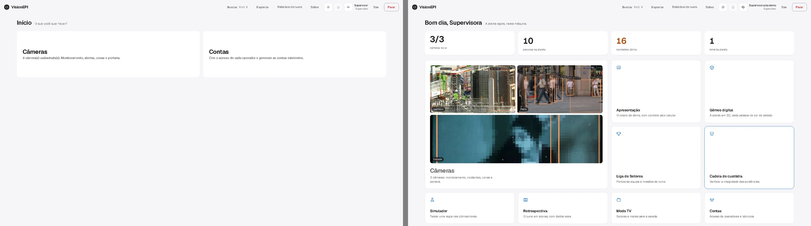
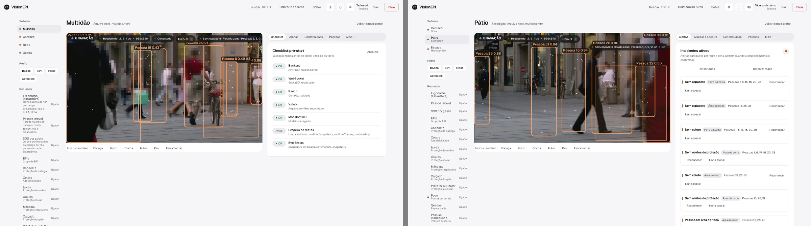
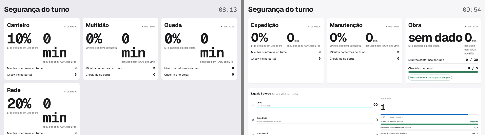
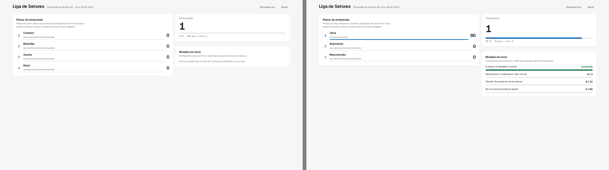
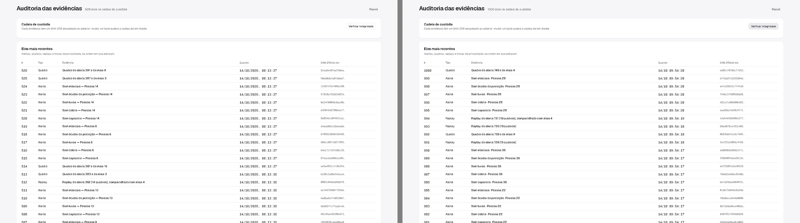
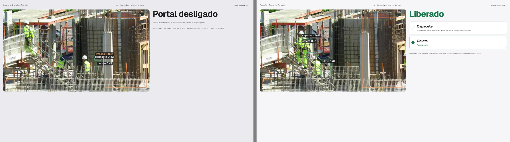

## Capturas finais

Uma pasta por variação: [1920×1080 claro](1920x1080-claro/), [1920×1080 escuro](1920x1080-escuro/),
[1366×768 claro](1366x768-claro/), [1366×768 escuro](1366x768-escuro/),
[390×844 claro](390x844-claro/), [390×844 escuro](390x844-escuro/).

Destaques:

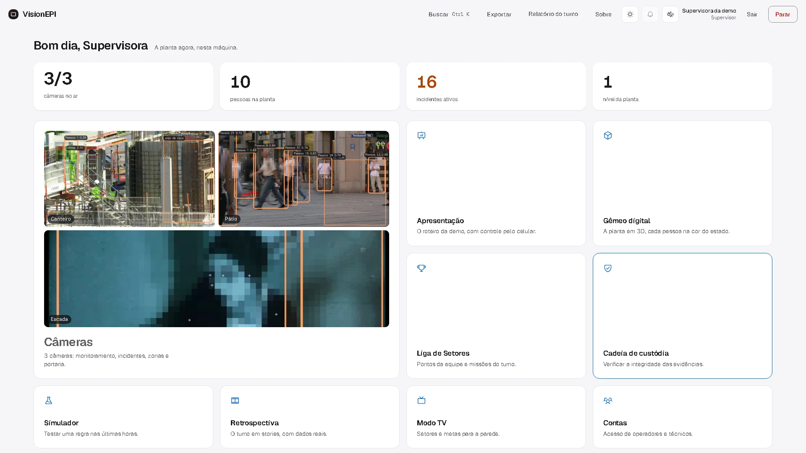
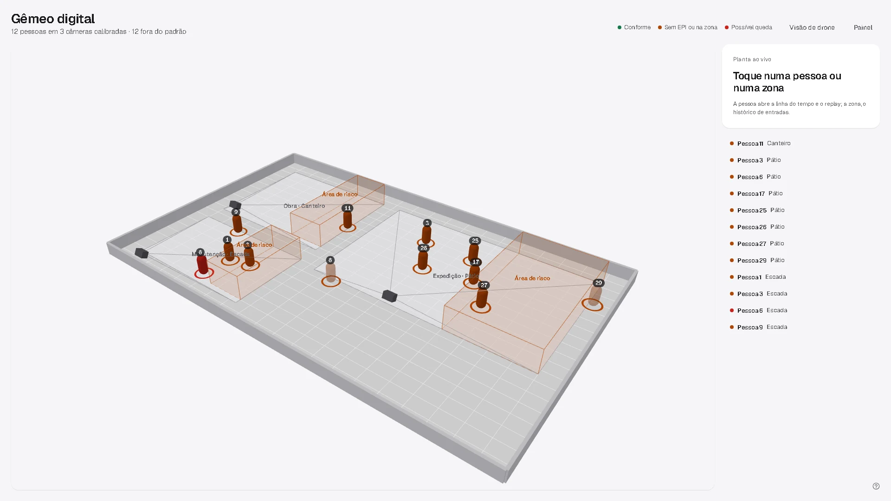
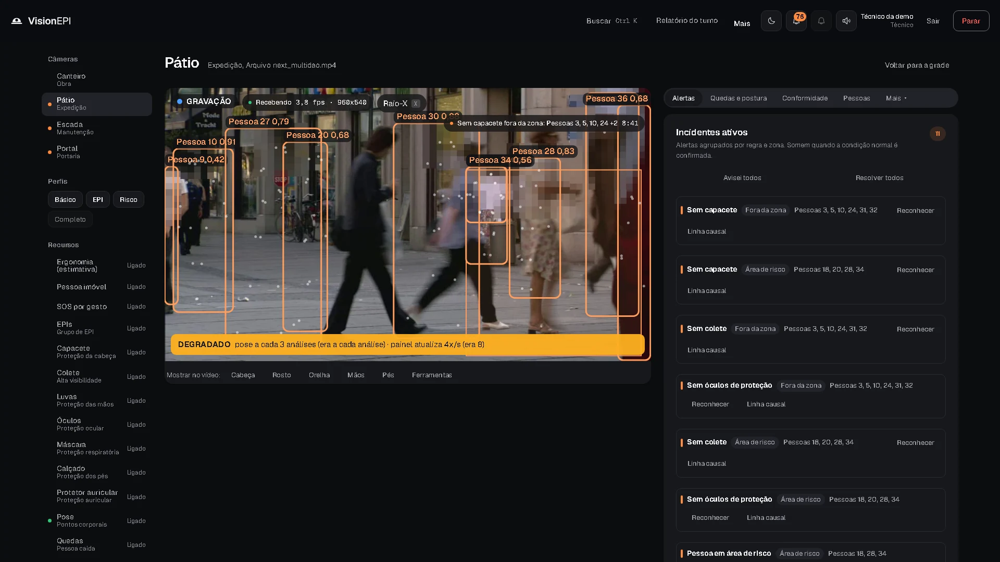
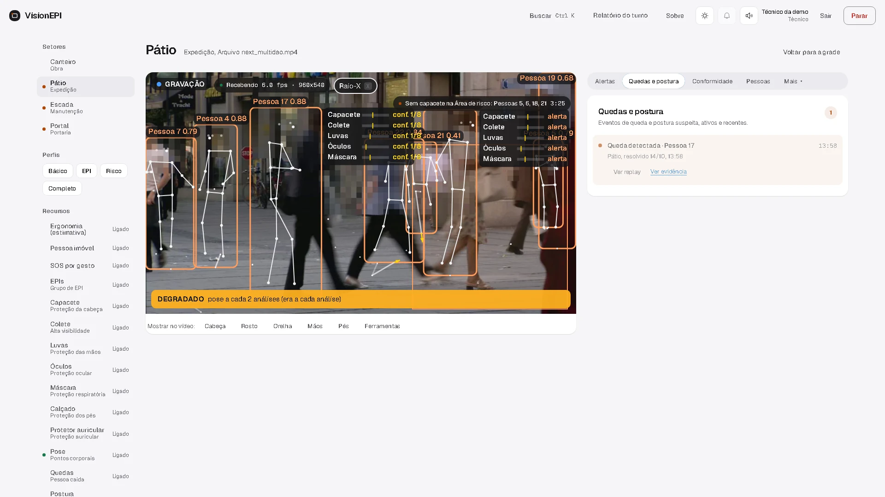
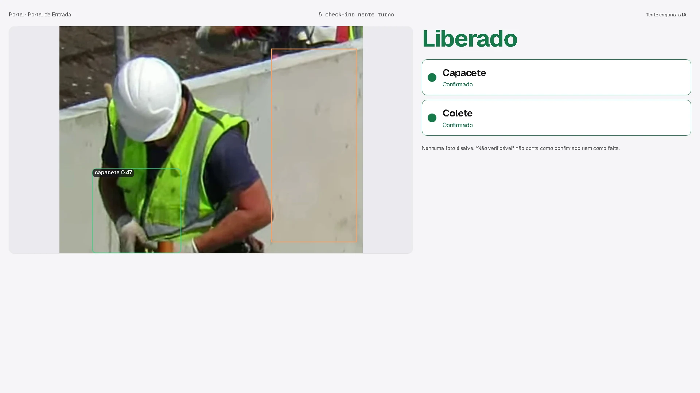
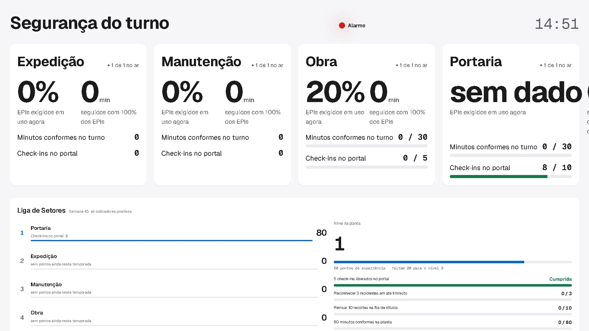
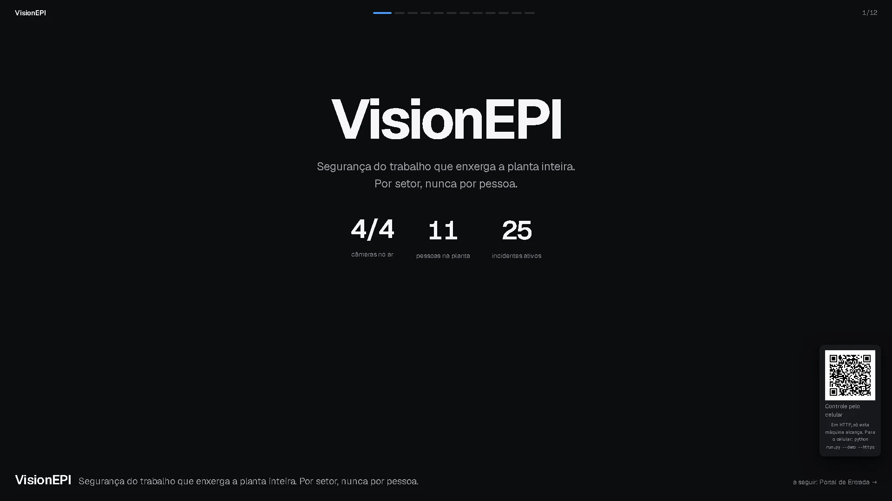
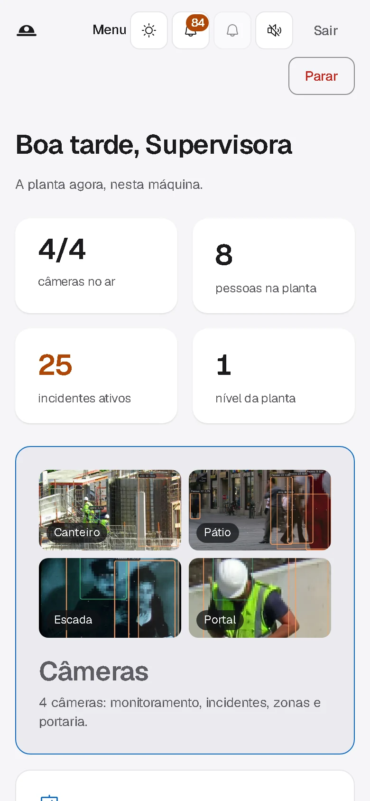
