# Galeria e revisão visual (MISSÃO 2, Fase C)

Capturas de `e2e/capturas_de_tela.py` contra a **própria demo** (`run.py --demo`,
sem webcam, depois de 3 min no ar para os números serem reais), em 1920×1080,
1366×768 e 390×844 (celular), tema claro e escuro. WebP ≤ 250 KB por
`scripts/galeria.py`. Rostos desfocados pelo modo privacidade, como o sistema
entrega.

Os arquivos `*-forcado-*` são a tela real com **dado de teste injetado no
navegador** (latência de rede ou resposta trocada), para mostrar os estados
"carregando", "vazio" e "degradado" de forma determinística. Os demais estados
(alerta crítico, sem sinal) são reais.

## Rubrica

Cada tela recebeu nota de 0 a 5 em oito itens, nas 6 variações (tamanho × tema):
**H** hierarquia · **A** alinhamento · **E** espaçamento · **C** contraste e
legibilidade a 5 m · **S** consistência com o sistema de design · **D**
densidade · **T** não parece template · **B** uma banca ficaria impressionada.
"Antes" = rodadas r1/r2 (pior variação); "final" = r6 (pior variação). Tudo
abaixo de 4 foi corrigido e capturado de novo; as rodadas r3 a r5 foram as
iterações intermediárias.

| tela | antes (H A E C S D T B) | final (H A E C S D T B) | o que mudou |
|---|---|---|---|
| 01 Login | 4 4 4 4 4 3 2 2 | 5 4 4 5 5 4 4 4 | painel de marca com três fatos verdadeiros ao lado do formulário |
| 02 Início do supervisor | 2 3 2 4 3 1 1 1 | 5 4 4 5 5 4 4 5 | a planta agora (4 números ao vivo) + bento com câmeras reais 2×2 e as entradas da missão |
| 03 Câmeras | 3 3 3 4 4 3 3 3 | 4 5 4 5 5 4 4 4 | cartão diz o estado do feed e quantos incidentes; grade maior |
| 04 Contas | 2 3 2 4 3 1 1 1 | 4 4 4 5 5 4 4 4 | direto na lista, "Nova conta" no cabeçalho, sem "conta(s)" |
| 05 Sobre e licenças | 4 4 4 5 4 4 4 3 | 4 4 4 5 5 4 4 4 | ícones visíveis na barra |
| 06 Prova de escala | 4 4 4 4 4 4 4 4 | 4 4 4 5 5 4 4 4 | — |
| 07 Foco, alerta crítico | 3 3 3 3 3 2 3 3 | 4 4 4 4 5 4 4 5 | alertas como aba inicial; pílulas sem disputa (alerta na 2ª linha); lateral sem textos de 5 linhas |
| 08 Abas do foco | 3 4 3 4 3 3 3 3 | 4 4 4 4 5 4 4 4 | "Checklist técnico" no fim; nomes em português |
| 09 Raio-X | 3 3 3 2 4 1 4 4 | 4 4 4 4 4 4 5 5 | no máximo 3 painéis, sem sobrepor (as maiores pessoas) |
| 10 Gêmeo 3D | 4 4 4 4 4 4 5 5 | 5 4 4 4 5 4 5 5 | lista "Pessoa 3 · Pátio" sem colar o número |
| 11 Gêmeo 2D (sem WebGL) | 4 4 4 4 4 4 4 4 | 4 4 4 4 5 4 4 4 | — |
| 12 Simulador | 3 2 4 4 4 4 4 4 | 4 5 4 4 5 4 4 5 | os dois painéis alinhados; "2,0 s"; plural certo |
| 13 Auditoria | 4 4 4 4 4 4 4 4 | 4 4 4 5 5 4 4 5 | data curta `14/10 09:04:50`; tabela rola no celular sem a coluna de hash |
| 14 Liga de Setores | 4 4 4 4 4 3 4 4 | 4 4 4 5 5 4 4 4 | skeleton no formato final |
| 15 Retrospectiva | 4 4 3 5 4 3 4 3 | 4 4 4 5 5 4 4 4 | abre pelo cartão com dado; os zerados vão para o fim |
| 16 Modo TV | 3 3 3 2 3 3 4 3 | 5 4 4 5 5 4 4 5 | "0 min" numa linha, unidade menor, sans tabular; setores cabem na tela |
| 17 Portal | 4 3 4 4 4 4 4 4 | 5 4 4 5 5 4 4 5 | "Iniciar câmera" só com a câmera parada |
| 18 Tente enganar a IA | 4 4 4 4 4 4 4 5 | 4 4 4 5 5 4 5 5 | — |
| 19 Rotular | 4 4 4 4 4 4 4 4 | 4 4 4 5 5 4 4 4 | — |
| 20 Você vs. a IA | 3 3 3 4 4 2 3 3 | 4 4 4 5 5 4 4 4 | cartão centrado e maior; "rodadas" |
| 21 Relatório de turno | 3 4 4 4 2 4 3 3 | 4 4 4 5 4 4 4 4 | Geist, hora local, decimal com vírgula, botão do sistema |
| 22 Palco (abertura) | 5 5 5 5 5 4 5 5 | 5 5 5 5 5 4 5 5 | no celular não transborda e não mostra o QR |
| 23 Quiosque do operador | 3 4 4 4 3 4 4 3 | 4 4 4 5 5 4 4 4 | sem código interno no aviso; "Iniciar câmera" só parada |
| 24 Controle do palco (celular) | 4 4 4 5 4 4 4 4 | 4 4 4 5 5 4 4 4 | — |
| 25 Celular como câmera | 4 4 4 4 4 4 4 4 | 4 4 4 5 5 4 4 4 | — |
| 26 Carregando (forçado) | 2 4 4 4 3 3 3 3 | 4 4 4 4 5 4 4 4 | skeleton com o formato do conteúdo |
| 27 Vazio (forçado) | 4 4 4 4 4 4 4 4 | 4 4 4 4 5 4 4 4 | — |
| 28 Degradado (forçado) | 4 4 4 4 4 4 4 4 | 4 4 4 4 5 4 4 4 | — |
| 29 Sem sinal (real) | 3 4 4 3 3 4 4 4 | 4 4 4 4 5 4 4 4 | quadro do servidor diz "Sem sinal" em português |
| Celular, todas | 2 3 2 4 3 2 3 2 | 4 4 4 5 5 4 4 4 | barra numa linha com "Menu"; palco e tabelas sem transbordar |
| 30 Palco, cena do Portal (nova, r7) | — | 5 4 4 5 5 4 4 5 | só a câmera do portal analisa; rodapé "Canteiro, Escada, Pátio: pausadas pela apresentação"; coluna reserva o espaço do QR abaixo de 1600 px |

### Rodada r7 (ADENDO 3): só as telas que mudaram

`python e2e/capturas_de_tela.py --rodada r7 --telas "02-,03-,07-,09-,17-,18-,22-,23-,30-"`
(e `r7b` para a 30 depois da correção). O que mudou desde a r6 e a nota que ficou:

| tela | mudança | nota final (H A E C S D T B) | achado da revisão |
|---|---|---|---|
| 02 Início | 4 câmeras (a "Portal" toca `portal.mp4`) | 5 4 4 5 5 4 4 5 | — |
| 03 Câmeras | 4º cartão; estado "pausada pela apresentação" quando o palco pausa | 4 5 4 5 5 4 4 4 | — |
| 07/09 Foco | aba que não cabe vai para o "Mais" | 4 4 4 4 5 4 4 5 | a 1280 px "Pessoas" pintava por cima do "Mais" (achado pelo E2E); corrigido |
| 17/18 Portal | um trabalhador de capacete e colete, de perto | 5 4 4 5 5 4 4 5 | — |
| 22 Palco | 4/4 câmeras | 5 5 5 5 5 4 5 5 | — |
| 23 Quiosque | o operador é do Portal: "ENTRADA LIBERADA/NEGADA" com a pessoa de perto | 4 4 4 5 5 4 4 5 | — |
| 30 Palco, Portal | nova | 5 4 4 5 5 4 4 5 | a 1366 px o QR cobria o fim da coluna (r7); corrigido na r7b |

O antes/depois abaixo continua r0 × r6.

Achados transversais que valeram para todas as telas (ícones invisíveis nos
botões, `<button>` em bloco, `.card + .card` em grade, código interno em texto):
ver "O que a revisão visual mudou" em [DESIGN.md](../DESIGN.md).

## Antes e depois

Antes = código do PR5 (`bench/runtime/capturas/r0`), depois = r6; 1920×1080, claro.

## Capturas finais

Uma pasta por variação: [1920×1080 claro](1920x1080-claro/), [1920×1080 escuro](1920x1080-escuro/),
[1366×768 claro](1366x768-claro/), [1366×768 escuro](1366x768-escuro/),
[390×844 claro](390x844-claro/), [390×844 escuro](390x844-escuro/).

Destaques:

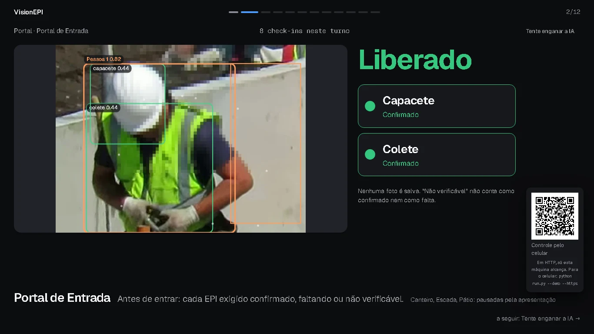

## MISSÃO 4 — telas novas e revisão (rodadas m4r3 a m4r7)

`python e2e/capturas_de_tela.py --rodada m4r3` contra a demo (3 min no ar), as 6 variações; telas corrigidas
recapturadas em `m4r4`–`m4r7`; a galeria saiu da junção `m4final` (50 telas × 6 variações = 300 capturas).
Mesma rubrica de 0 a 5 (H A E C S D T B), nota da **pior variação** depois das correções. Nada ficou abaixo de 4.

| tela | final (H A E C S D T B) | achado da revisão e o que mudou |
|---|---|---|
| Barra superior, celular (todas as telas) | 4 4 4 5 5 4 4 4 | **bug:** a 390 px a página tinha 700 px de largura e "Sair"/"Parar" ficavam fora da tela (a regra do "Mais" no `missao4.css` anulava o `display: none` do celular); a barra agora quebra em duas linhas com a marca na primeira. E2E `test_barra_superior_cabe_no_celular` |
| Barra superior, desktop | 5 4 4 5 5 4 4 5 | "Mais" 6 px abaixo dos outros atalhos (margem genérica do `details`). E2E `test_mais_alinhado_com_os_outros_atalhos_da_barra` |
| 29 Sem sinal | 4 4 4 4 5 4 4 4 | dois selos diziam "reconectando" (um em caixa alta, outro cortado no celular); fica um |
| 40 Torre de luz | 5 4 4 5 5 4 5 5 | — (no escuro a luz vermelha aparece na fase apagada da piscada da sirene: é o estado real) |
| 41 Evacuação | 4 4 4 5 5 4 4 4 | estado vazio encostado à esquerda de um cartão de 1760 px; centrado |
| 42 Editor de regras | 4 4 4 5 5 4 4 4 | — |
| 43 Permissão de trabalho | 4 4 4 5 5 4 4 4 | — |
| 44 Central de ajuda | 4 4 4 5 5 4 4 4 | — |
| 45 Status do sistema | 4 4 4 5 5 4 4 4 | "reduzindo a carga para acompanhar" e "defina … no arquivo" saíam em monoespaçada; só o código fica mono. No celular a tabela de modelos rola na horizontal (padrão `tabela-rolavel`) |
| 46 Novidades | 4 4 4 5 5 4 4 4 | — |
| 47 Configurações | 4 4 4 5 5 4 4 4 | nome e tipo de conta em monoespaçada; valores agora na fonte do texto |
| 48 Busca nas trilhas | 4 4 4 5 5 4 4 4 | — (o "dd/mm/yyyy" do campo de data é o do navegador headless em inglês) |
| 49 Antes e depois | 4 4 4 5 5 4 4 4 | coluna de 1200 px começava em x = 384 enquanto as outras telas começam em 80; gutter padrão |
| 50 Relatório mensal (CIPA) | 4 4 4 5 5 4 4 4 | — |
| 51 Documentação da API | 4 4 4 5 4 4 4 4 | fonte do sistema; agora Geist e Geist Mono, como o resto |
| 52 Página não encontrada | 5 4 4 5 5 4 4 4 | — |
| 53 Primeiro acesso | 4 4 4 5 5 4 4 4 | — |
| 54 Caixa de entrada | 4 4 4 5 5 4 4 4 | "Nada por aqui ainda" é o que o `MARCA.md` manda evitar; "Nenhuma mensagem ainda" |
| 55 Página do produto | 5 4 4 5 5 4 4 5 | **bug:** no celular o botão do topo ficava cortado na borda (`a.button.primary` vencia o `display: none`). E2E `test_produto_cabe_no_celular` |

Capturas que falhavam e passaram a sair: no celular, 04 (contas), 28 (degradado) e 29 (sem sinal) não eram
clicáveis por causa da barra estourada; 30 (palco no portal) falhou por tempo em duas variações da m4r3 e saiu
na recaptura.

### Antes e depois (MISSÃO 4)

Antes = `m4r3`, depois = `m4final`.

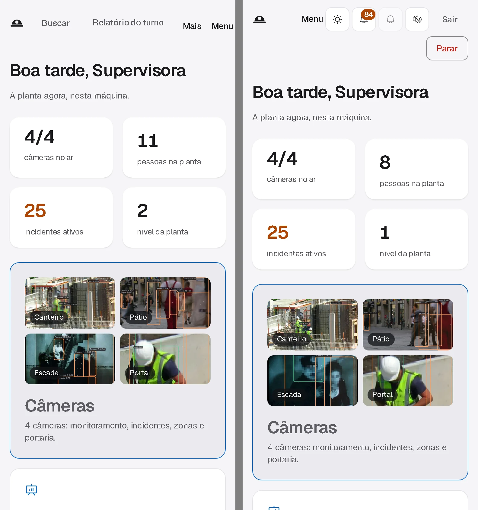
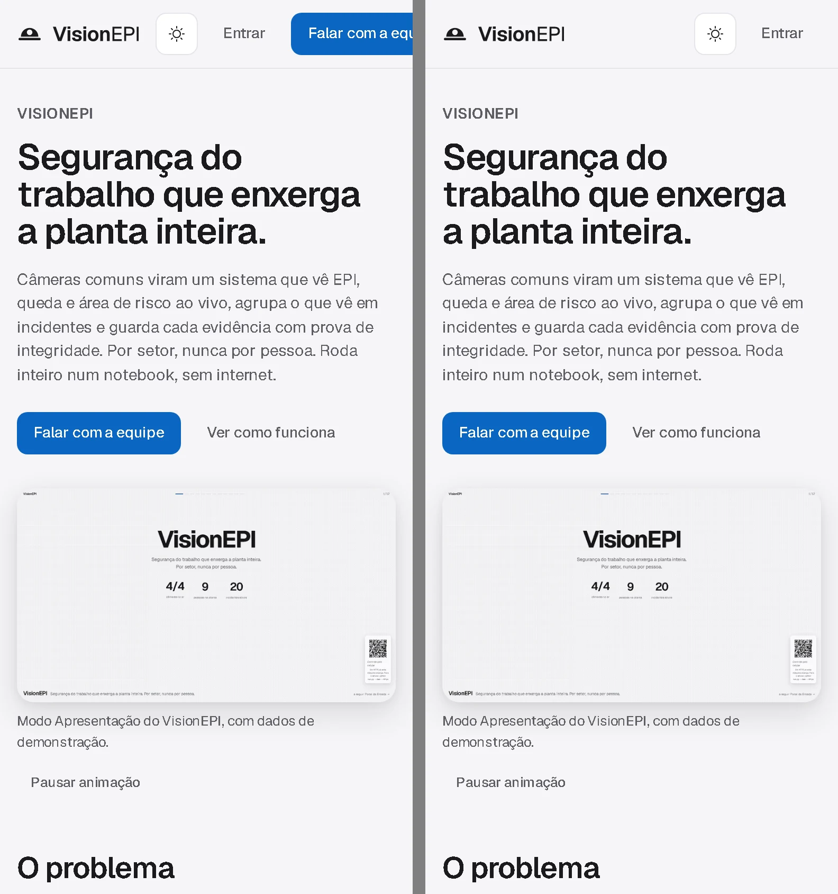
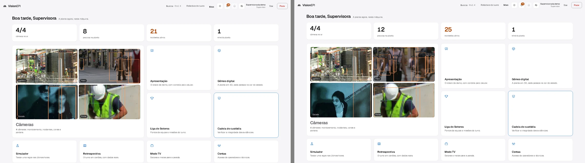
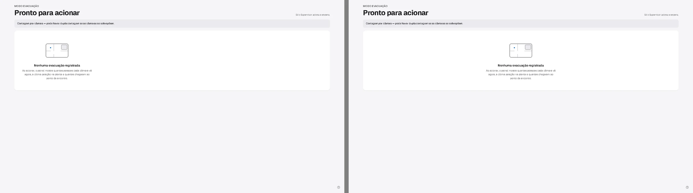
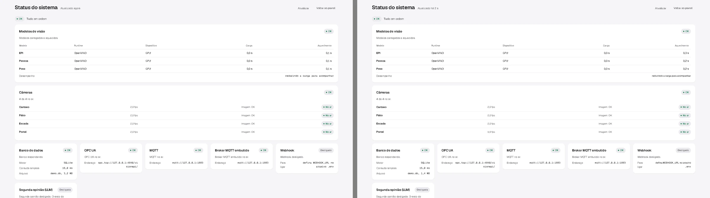
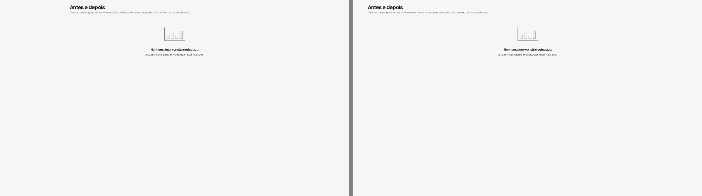

Destaques da MISSÃO 4:

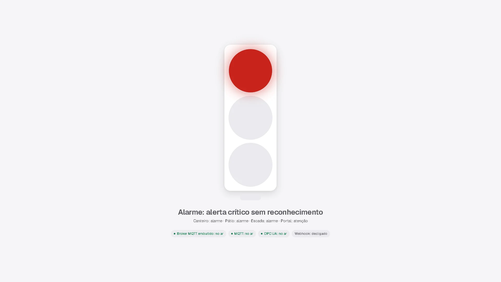
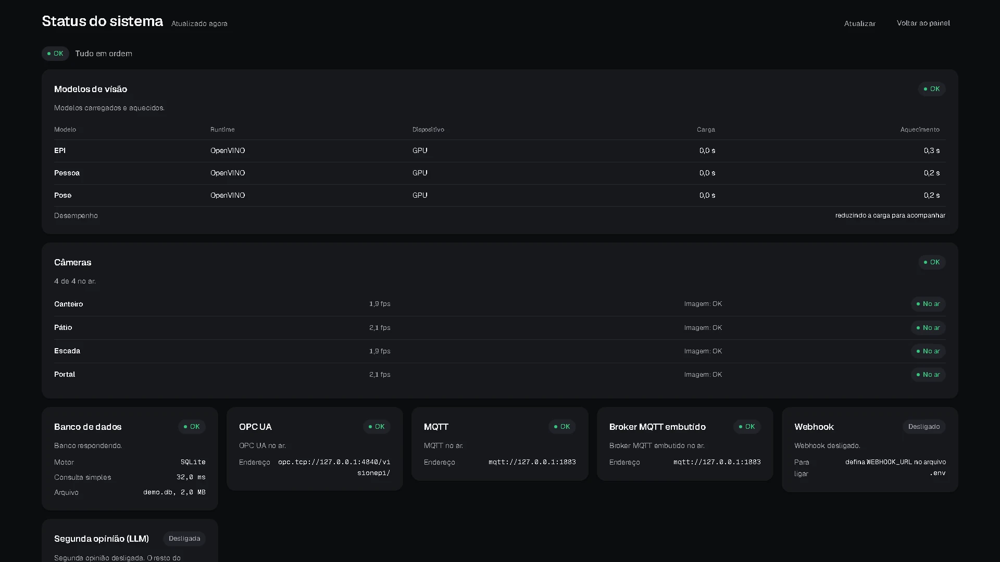
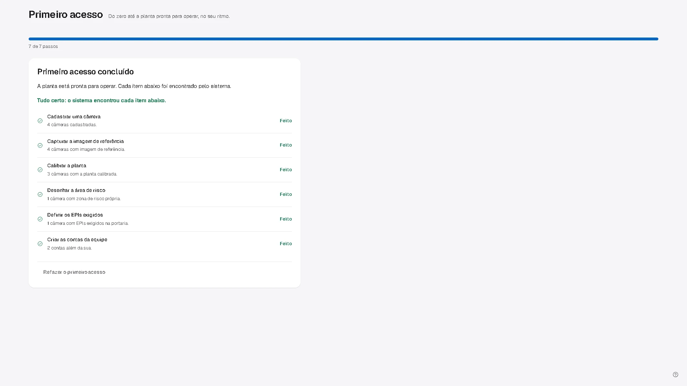
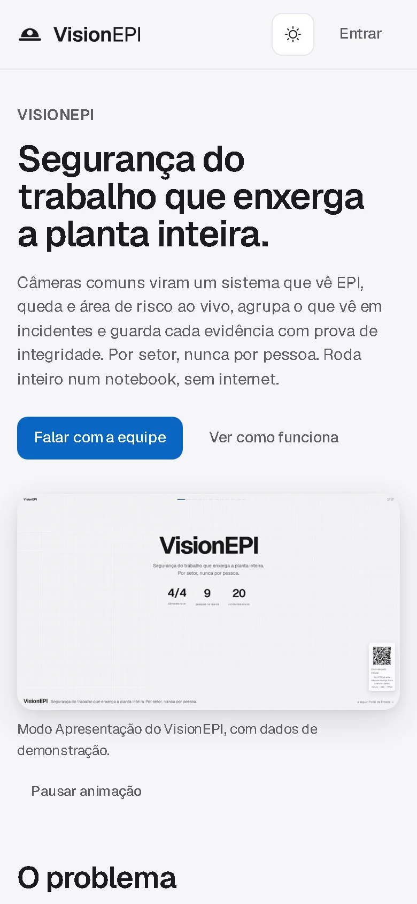
