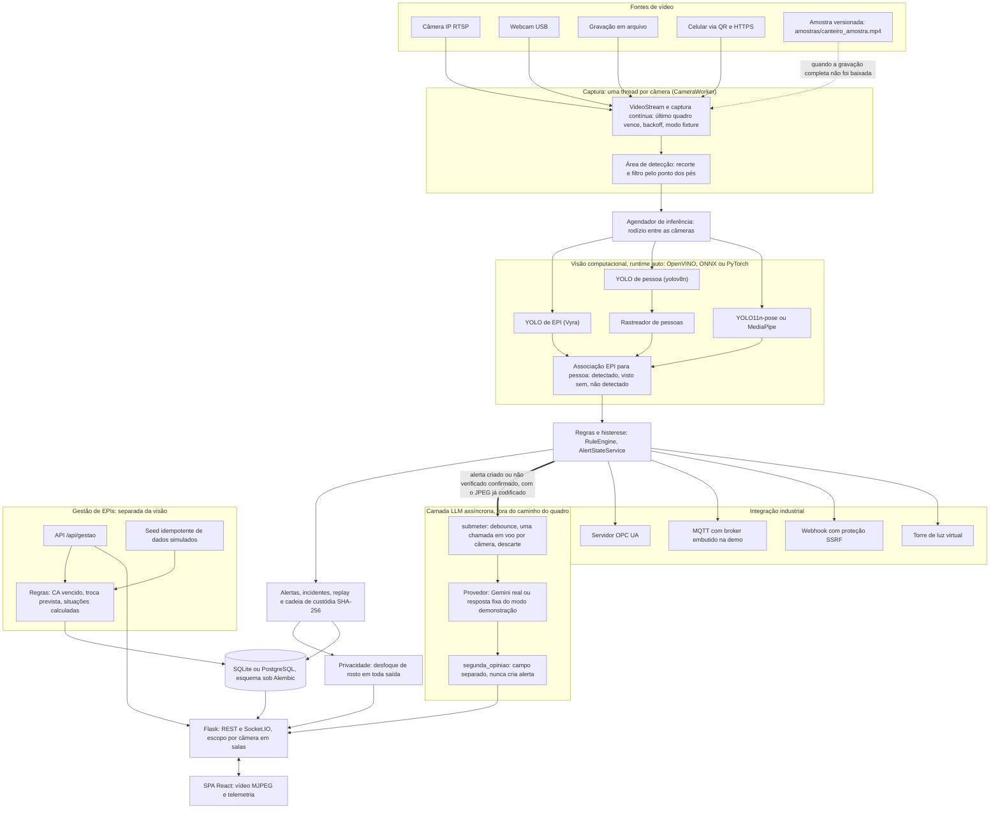
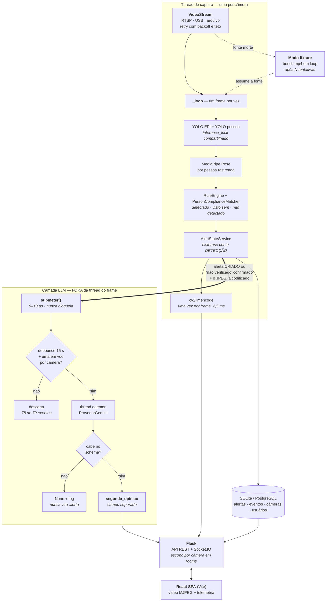
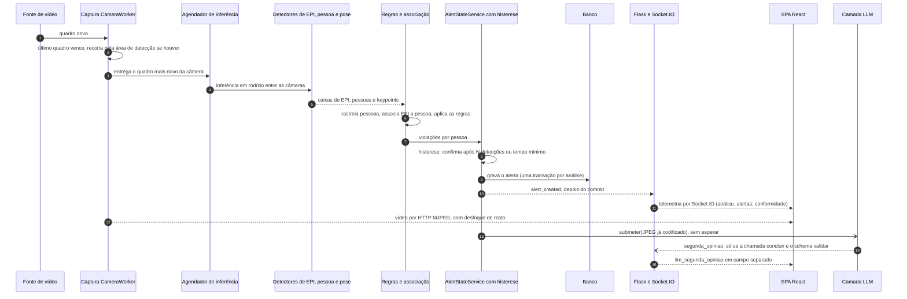
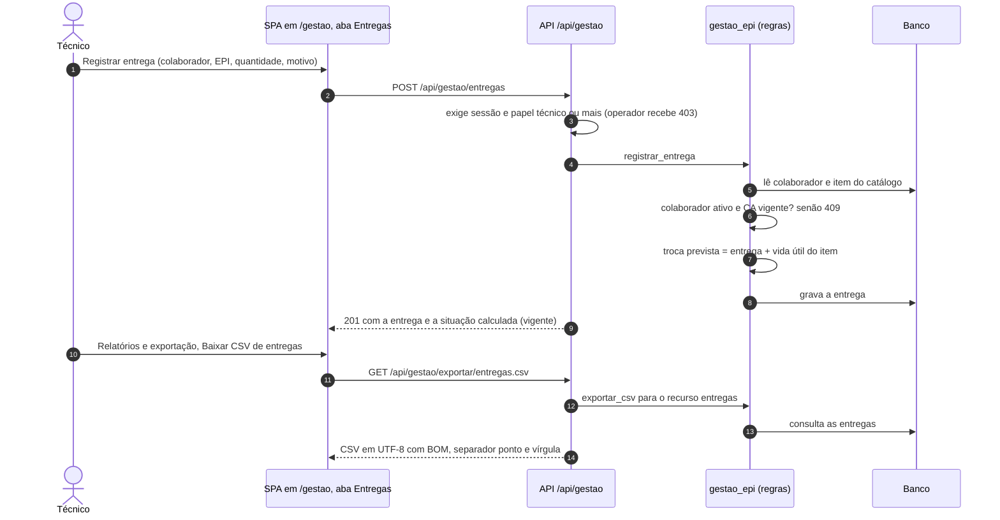

# Arquitetura do VisionEPI

Segurança industrial com visão computacional para a Metaindústria (Challenge FIAP x SPI 2026). Este documento descreve o que existe no
repositório em 23/10/2026, com fonte em cada número. Decisões com consequência duradoura têm um ADR curto em [adr/](adr/README.md).
Requisitos e rastreabilidade: [requisitos.md](requisitos.md). Evolução por sprint: [evolucao-sprints.md](evolucao-sprints.md).

## 1. Visão geral

O sistema lê câmeras comuns (RTSP, USB, arquivo, celular), roda detectores de EPI, pessoa e pose, aplica regras com histerese e transforma
o resultado em alertas, incidentes e evidências com cadeia de custódia. Um servidor Flask expõe REST e Socket.IO; uma SPA React mostra o
vídeo e a telemetria por perfil (operador, técnico, supervisor). Duas peças ficam **fora** do caminho do quadro: a segunda opinião de um LLM
(ADR 0003) e o módulo **Gestão de EPIs**, um cadastro administrativo de colaboradores, catálogo com CA, entregas e ocorrências, deliberadamente
separado da visão (ADR 0008).

Princípios que organizam o desenho:

- **Por setor, nunca por pessoa** (ADR 0005): ID de rastreio não é identidade; rosto desfocado em toda saída.
- **O quadro não espera ninguém**: rede, LLM e gravação em disco ficam fora da thread de captura (ADR 0003, RNF04).
- **Medir antes de trocar**: troca de runtime ou de resolução só passa por um guarda de concordância (ADR 0006).
- **Ausente não é não visto**: cada EPI sai como detectado, visto sem ou não detectado (`docs/SPRINT4.md` §5).

## 2. Diagrama de componentes

Leitura rápida: as setas sólidas são o caminho do quadro, síncrono; a seta grossa para a camada LLM é o único ponto de contato com ela e
nunca bloqueia. O bloco Gestão **não** recebe seta da visão. A única ligação possível é opcional e de evento: `ocorrencias.alerta_id`,
inteiro sem chave estrangeira (ADR 0008).

### Detalhe do caminho do frame e da camada LLM (do README)

Este é o diagrama que já existia no README, mantido aqui como detalhe. Os números (2,5 ms, 9 a 13 microssegundos, 78 de 79 eventos)
vêm de `docs/BENCH.md` e `docs/SPRINT3.md`.

Esse diagrama é da Sprint 3 e descreve o laço **serial** daquela época (um `inference_lock` compartilhado, MediaPipe depois do YOLO). No NEXT 2026
o laço foi reorganizado: captura em thread própria por câmera ("último quadro vence"), um agendador único de inferência em rodízio, pose por
YOLO11n-pose em uma passada, encode só sob demanda (CHANGELOG do NEXT, §4.1). O diagrama da seção 2 mostra o desenho atual.

## 3. Fluxos de dados

### 3.1 De um quadro até o alerta na tela

Fontes: ordem das etapas em `docs/NEXT2026/CHANGELOG.md` §4.1 e "Achados de desempenho do perfil batata" (uma transação por análise, eventos
depois do commit); histerese por tempo e por confirmação (`ALERT_CREATE_AFTER_SECONDS`, `ALERT_MIN_CONFIRMATIONS`); LLM em
`docs/SPRINT3.md`. Latência medida do primeiro quadro com a violação até o alerta chegar ao navegador, perfil batata, 1 câmera: **1,941 s**
no portão do PR2, indicativo sob carga (`docs/NEXT2026/BENCHMARKS.md`).

### 3.2 De uma entrega de EPI até o CSV

Fonte: contrato `docs/specs/es-sprint4-contrato-gestao.md` e `app/services/gestao_epi.py` (`registrar_entrega`, `exportar_csv`). Nenhuma etapa
toca a visão: o fluxo não lê câmera, ID de rastreio nem imagem.

## 4. Onde cada coisa mora

| Camada | Pasta ou arquivo | Responsabilidade |
|---|---|---|
| Entrada do processo | `run.py`, `wsgi.py` | `python run.py` (dev), `--demo`, `--https`; gunicorn sobre `wsgi:app` em produção |
| Aplicação Flask | `app/__init__.py`, `app/config.py`, `app/extensions.py` | fábrica, configuração por variável de ambiente, Socket.IO |
| API REST | `app/api/*.py` (um blueprint por assunto) | rotas; `app/api/gestao.py` é o módulo novo |
| Serviços | `app/services/` | monitor, workers, alertas, incidentes, custódia, relatórios, integração, gestão |
| Visão | `app/vision/` | captura, detectores, rastreio, pose, associação, saúde visual, área de detecção, privacidade |
| LLM | `app/llm/` (schema, provedores, prompts v1 e v2) | só recebe imagem e devolve `AnaliseRisco` ou `None` |
| Dados | `app/models.py`, `app/repositories/`, `migrations/versions/` | 20 migrações Alembic; última `a8b9c0d1e2f3` (Gestão) |
| Demo | `app/demo.py`, `app/demo_ambiente.py`, `amostras/` | banco isolado, contas, câmeras, amostra versionada |
| Frontend | `frontend/src/` (`components/`, `store/`, `socket/`, `api/`, `styles/tokens.css`) | SPA; build em `app/static/dist` (versionado) |
| Testes | `tests/` (pytest), `e2e/` (Playwright com servidor real) | ver `docs/requisitos.md` e `docs/scrum/definition-of-done.md` |
| Scripts | `scripts/` | `preparar.py`, `fetch_fixtures.py`, `concordancia.py`, `bench.py`, avaliação |

## 5. Stack e justificativa

"Sem justificativa registrada" significa que nenhum documento do repositório explica a escolha; não inventei uma. Números só entram com a
fonte ao lado.

| Escolha | Por que, e onde está escrito |
|---|---|
| Python 3.11 a 3.12 | `mediapipe==0.10.14` e `numpy==1.26.4` não publicam wheel acima da 3.12 e o `pip install` falha antes de instalar qualquer coisa (README, Pré-requisitos) |
| Flask 3.0.3 + Flask-SQLAlchemy + Flask-Migrate | Alembic como dono do esquema: ADR 0004. Escolha do Flask em si: sem justificativa registrada (herdada do protótipo de 19/07) |
| Flask-SocketIO, modo `threading` | telemetria ao vivo; o cliente força `polling` e, nesse modo, binário vai em base64 (+33 %), por isso o vídeo não passa pelo socket (`docs/NEXT2026/PESQUISA.md` §9, CHANGELOG §4.1; ADR 0001) |
| gunicorn | "o servidor de desenvolvimento do Werkzeug nunca é usado fora de dev" (README, Stack) |
| Ultralytics YOLOv8, peso Vyra (YOLOv8m, 14 classes, CC-BY-4.0) | modelo dedicado de EPI com classe `Fall-Detected`; exige atribuição ao autor (README, "Configuração do modelo de EPI") |
| YOLOv8n (COCO) para pessoa | a classe `Person` do Vyra não generaliza: zero detecções em 36 células; custo de -20 % de FPS (ADR 0002; `docs/BENCH.md`) |
| YOLO11n-pose por padrão, MediaPipe selecionável (`POSE_BACKEND`) | uma passada para todas as pessoas, esqueleto associado ao track por IoU (CHANGELOG §4.4). `POSE_BACKEND` tem padrão `yolo` em `app/config.py`. O MediaPipe por pessoa foi o desenho da Fase 2 até o relatório de IA de 28/09; nele, `static_image_mode=False` seria 2,25x mais rápido e não foi aplicado (`docs/SPRINT3.md`) |
| OpenVINO (iGPU Intel) e ONNX Runtime, com PyTorch como reserva | CPU do servidor por análise de 6.432 ms (ONNX) para 1.401 ms (OpenVINO GPU FP32), -78 %, batata 1 câmera (CHANGELOG, L1; ADR 0006). Ultralytics fixado em 8.3.40 |
| Peso próprio `models/visionepi_cppe_n416.pt` (YOLOv8n, 6,2 MB, versionado) | alternativa configurável: precisão do alerta "sem capacete" 0,39 para 0,85 e FPS 3,42 para 11,15 na máquina de 2 núcleos (`docs/SPRINT4.md`). Não é o padrão porque as medições do NEXT foram feitas com o Vyra (README) |
| Google Gemini 3.6 Flash (opcional) | `gemini-2.0-flash` foi aposentado (404); versão fixa para os goldens não mudarem de significado (`docs/SPRINT3.md`; ADR 0003) |
| SQLite (dev e demo) e PostgreSQL (produção, via Docker) | README, Stack. Justificativa além disso: sem registro. A demo usa banco isolado em SQLite (ADR 0007) |
| OPC UA (asyncua), MQTT (paho-mqtt e broker embutido amqtt), webhook | estado da planta que "um CLP lê"; tudo desligado por padrão e ligado na demo; licenças verificadas, asyncua é LGPL-3.0-or-later (CHANGELOG, MISSÃO 4, M2 e "Fontes verificadas") |
| React 18 + TypeScript + Vite | build servido pelo Flask (ADR 0001). O `tsc -b` do `npm run build` é a checagem de tipos do front; não há ESLint (`docs/specs/ESTADO-es-sprint4.md`) |
| Zustand | "estado global, assinando os eventos WebSocket" (README, Stack) |
| three.js, `motion`, `@number-flow/react`, `cmdk` | gêmeo 3D (three), animação, números que transitam, paleta de comandos (README e `frontend/package.json`); o uso do three no gêmeo 3D é lido do código (`frontend/src/components/gemeo/cena3d.ts`), não de um texto de justificativa |
| Sistema de design em `frontend/src/styles/tokens.css`; Geist e Phosphor | cor só para estado; tema claro como padrão da demo (projetor); fontes self-hosted para funcionar offline; um conjunto único de ícones (`docs/NEXT2026/DESIGN.md`) |
| pytest, ruff, Playwright (Python), axe-core | portão de qualidade (`docs/scrum/definition-of-done.md`); `e2e/` sobe servidor real com as gravações |

## 6. Decisões técnicas por sprint

As sprints são as do Challenge (16/04 a 04/05, 05/05 a 22/06, 23/06 a 24/08, 25/08 a 23/10). Para S1 e S2 não há commits na `main`; as
decisões vêm dos relatórios de fase (**reconstruído a partir dos documentos de fase, sem commits na main**).

**Sprint 1 (Fase 1, detecção de EPIs).** Ensemble de dois modelos YOLOv8 fundidos por IoU (Vyra e um modelo treinado no SH17); três estados por EPI
por faixa vertical na caixa da pessoa; associação geométrica exclusiva EPI e pessoa; rastreador por IoU com distância de centros como reserva;
piso de confiança por classe e filtro geométrico; zona de risco desenhada no vídeo, por câmera. O ensemble ainda existe
(`app/vision/ensemble_ppe_detector.py`), mas `PPE_EXTRA_MODELS` vem vazio por padrão.

**Sprint 2 (Fase 2, pose).** Pose por pessoa com MediaPipe no mesmo `CameraWorker` e no mesmo quadro; queda por orientação do torso em
**pixels**, postura suspeita por projeção da cabeça em **fração do torso**, aproximação por centro da caixa dentro do polígono.

**Sprint 3 (Fase 3, notificação inteligente).** Severidade explícita por regra; dois canais (visual e sonoro; o sonoro sintetizado por código, sem
arquivo de áudio de terceiro); portaria assimétrica (nega em 3 quadros, libera em 8); contas de operador restritas à câmera do setor, criadas pelo
supervisor. No git (19/07 a 24/08): protótipo V5, migração para React (05/08), interface multicâmera (23/08), Vyra, pose por pessoa, reconexão com
backoff e autenticação com papéis (24/08). Latência E2E medida: 1,17 s para severidade alta (meta 5 s), 1,37 s para crítica (meta 1 s, 37 % acima).

**Sprint 4 (25/08 a 23/10).**
- 08 e 09/09: Alembic dono do esquema (ADR 0004), escopo de câmera no WebSocket, detector de pessoa ligado por padrão (ADR 0002), histerese que conta
  detecção, camada LLM (ADR 0003), cadastro de câmera por CLI, credencial RTSP redigida, modo fixture, descarte de quadro atrasado em fonte de rede
  (latência 13,5 s para 2,55 s, `docs/BENCH.md`, Fase 7).
- 23/09: relatório da Fase 4 (câmeras RTSP reais, 30 minutos sem reinício, confidencialidade das imagens reais).
- 28/09: peso próprio treinado no domínio, classes negativas e estado "não verificado", segundo gatilho do LLM, avaliação por pessoa (`docs/SPRINT4.md`).
- 14 a 22/10 (NEXT 2026): captura contínua e agendador único, runtime aprovado por guarda (ADR 0006), privacidade (ADR 0005), modo demonstração (ADR 0007),
  incidentes, custódia, gêmeo, simulador, Portal, Liga e palco; fábrica conectada, saúde visual, evacuação, editor de regras, permissão de trabalho,
  relatório mensal (MISSÃO 4); área de detecção (MISSÃO 7).
- 23/10 (esta entrega): Gestão de EPIs (ADR 0008), fallback do LLM na demo (ADR 0009), amostra versionada (ADR 0010).

## 7. Limitações conhecidas

Tiradas do Roadmap do README, dos `[~]` dos documentos de fase e das seções de limitação dos relatórios. Nenhuma foi suavizada.

**Gestão de EPIs (desta sprint, achados da auditoria aceitos como limitação)**
- "Hoje" é a data local do servidor (`gestao_epi.hoje()`): num servidor em UTC, CA e troca "vencem" às 21h de Brasília da véspera.
  Fuso configurável com `zoneinfo` foi adiado porque no Windows exige o pacote `tzdata` (dependência nova); a demo roda no horário local.
- Unicidade de matrícula e CA é checada antes de gravar; a corrida de dois cadastros simultâneos vira 409 `duplicado` pelo
  `IntegrityError`, não 500, mas a mensagem é genérica.
- Os dados do seed são fictícios e marcados (`ficticio`, `metadata_json.simulado`); o risco ao vivo os exclui, o relatório mensal os
  conta e avisa quantos são.

**Qualidade da detecção**
- As métricas de EPI da Fase 1 são contra o conjunto de teste do SH17, não contra imagens da planta; nenhuma classe atinge mAP@0,5 de 0,75
  (`FASE1` §3). O peso da Sprint 4 foi medido em um dataset de uma só distribuição; nunca em câmera da planta (`docs/SPRINT4.md` §7).
- PCK de pose **não medido**; o teste ao vivo de pose foi qualitativo. O rastreador trocou o ID da pessoa durante uma queda (`FASE2` §3).
- As 38 violações de capacete do conjunto de teste da Sprint 4 estão todas em cenas não industriais: o que se mede em canteiro é sobretudo o
  alerta falso. Classes negativas fracas (mAP50 entre 0,03 e 0,46); a política `evidencia` dispara só 27 % dos alertas devidos de capacete.
- O peso da Sprint 4 não tem classe de máscara; a tela mostra "indisponível". A revocação do colete caiu de 0,79 para 0,69.
- Uma queda que o modelo enxerga por menos de 1 s, num pátio com muitas câmeras em máquina fraca, pode não virar alerta (CHANGELOG, F2).

**LLM**
- Latência de 16 a 38 s por chamada; 3 cenas não sustentam afirmação de acurácia; a medição no conjunto anotado **não foi rodada**
  (`docs/SPRINT4.md` §7 e §8).
- Na demonstração sem chave a resposta é fixa e não analisa a imagem (ADR 0009).

**Desempenho**
- Multicâmera é limitada pela iGPU: no perfil batata com 4 câmeras, 0,34 análise por segundo por câmera contra 0,08 antes (README).
- Números do bench foram colhidos com a máquina disputada por outros processos; só as comparações intercaladas valem, os absolutos não são
  para a banca (`docs/NEXT2026/BENCHMARKS.md`, Limitações). A rodada de 22/10 de área de detecção ocorreu com 97 % de CPU tomada.
- Partida a frio é lenta (de 32 s a 248 s para compilar os modelos); salvar uma área de formato novo trava a análise por cerca de 21 s.
- As fixtures têm de 7 a 20 s e tocam em laço; o corte do laço fragmenta IDs. A latência de alerta é medida a partir do quadro 0, em que a
  violação já está presente.

**Funcional**
- Canal Telegram **não implementado** (RF48). Parâmetros da câmera só são relidos quando o worker é reconstruído (RF52). Ruído de alertas
  na multidão: 5 por pessoa e um conjunto novo a cada troca de ID (RF53). Pose por pessoa com instância própria **não aplicada** (RF51).
- Wi-Fi até as câmeras reais degradou a qualidade de detecção na Fase 4; o sistema continuou de pé (`FASE4` §2).
- O desfoque de rosto não alcança quem o detector de pessoa não viu (`app/vision/privacidade.py`).

**Gestão de EPIs (esta entrega)**
- Dados do seed são simulados e assim rotulados. Não existe cruzamento entre colaborador e violação detectada: é intencional (ADR 0005, 0008).
- O bloqueio de entrega com CA vencido é política da empresa, não texto literal da NR-6 (`app/services/gestao_epi.py`).
- Sem integração com sistema externo de SST nem com folha de pagamento.
- Cadastro de colaborador não tem CPF, foto nem dado sensível, por desenho; isso limita a identificação (matrícula é o único identificador).

**Demonstração**
- A amostra versionada tem 7 s e toca em laço; a demo com as gravações completas é a referência. Os pesos dos modelos continuam sendo baixados
  por `scripts/preparar.py` (ADR 0010).
- O banco da demo é recriado a cada subida: áreas desenhadas e dados lançados na sessão não sobrevivem ao reinício.

## 8. Veja também

- [adr/README.md](adr/README.md): índice dos 10 ADRs.
- [requisitos.md](requisitos.md): RF, RNF e matriz de rastreabilidade.
- [scrum/README.md](scrum/README.md): backlog, sprints, Definition of Done e ata final.
- [evolucao-sprints.md](evolucao-sprints.md): do protótipo ao produto, com métricas e commits.
- `docs/NEXT2026/BENCHMARKS.md` e `docs/NEXT2026/CHANGELOG.md`: medições e decisões detalhadas do NEXT 2026.
