# Manual de uso: passo a passo do avaliador

Este roteiro leva de um clone do repositório até a Gestão de EPIs, passando pelo monitoramento em tempo real. Tudo roda no **modo demonstração**: sem câmera IP,
sem chave do Gemini e com um banco isolado que não toca nos seus dados. Os prints ficam em `docs/img/` e são gerados com Playwright; se algum ainda não
aparecer, o texto descreve o que a tela mostra.

**O que este manual não afirma.** O caminho de instalação abaixo repete o que o README e `docs/NEXT2026/DEMO.md` descrevem; ele foi conferido contra
o código, mas **a execução limpa de ponta a ponta é o teste "avaliador" da entrega** (critério F2), registrado na [ata](scrum/ata-review-final-sprint4.md). Em macOS e
Linux os comandos são os mesmos trocando o caminho do Python; **não foram testados nessas plataformas por quem escreveu este manual**.

## 1. Antes de começar

- Python **3.11 ou 3.12** (não 3.13 ou mais: `mediapipe` e `numpy` fixados não publicam pacote para versões acima da 3.12; README).
- Internet **uma vez**, para baixar pesos dos modelos e gravações de demonstração. Depois disso a demo roda offline.
- Node não é necessário para rodar: o build do frontend (`app/static/dist`) já vem no repositório.
- Uma máquina folgada. A ameaça nº 1 em todas as medições foi CPU tomada por outros programas (Docker, Teams, Salesforce CLI): feche-os.

## 2. Subir a demonstração

### Windows (PowerShell)

```powershell
py -3.11 -m venv .venv
.venv\Scripts\python -m pip install -r requirements.txt
.venv\Scripts\python scripts\preparar.py
.venv\Scripts\python run.py --demo
```

### macOS e Linux (não testado nessas plataformas)

```bash
python3.11 -m venv .venv
.venv/bin/python -m pip install -r requirements.txt
.venv/bin/python scripts/preparar.py
.venv/bin/python run.py --demo
```

O que cada passo faz:

1. `pip install` instala as dependências (inclui PyTorch, OpenVINO e Playwright; pode demorar).
2. `scripts/preparar.py` baixa os pesos conferindo o SHA-256, baixa as gravações de demonstração, aprova os runtimes rápidos e aquece o cache do
   OpenVINO. **É o único passo que precisa de internet.**
3. `run.py --demo` cria o banco isolado `instance/demo/demo.db` do zero, cadastra as câmeras, cria as contas, **carrega os dados simulados da Gestão de EPIs** e
   sobe o servidor.

Espere cerca de **1 minuto** até a primeira análise aparecer: a mediana medida foi 53 s com o cache aquecido e 68 s a frio (`docs/NEXT2026/DEMO.md`).
Se a porta 5000 estiver ocupada, o `run.py --demo` avisa antes de subir. Use outra: no PowerShell, `$env:PORT="5050"` e rode de novo no mesmo terminal; no macOS/Linux, `PORT=5050 .venv/bin/python run.py --demo`. No modo demonstração o arquivo `.env` não é lido.

Se uma gravação de demonstração não foi baixada, `python scripts/fetch_fixtures.py` a baixa. Enquanto ela faltar, a câmera correspondente toca a amostra versionada
`amostras/canteiro_amostra.mp4` (7 s, CC BY-SA 4.0) e o terminal avisa quais câmeras estão nessa condição (`app/demo_ambiente.py`, ADR 0010). **Os pesos dos modelos
continuam vindo do `preparar.py`**: a amostra não dispensa a internet do passo 2. A subida num clone sem as gravações ainda não tem teste dedicado.

## 3. Entrar

O terminal imprime **só uma vez** o endereço e as três contas, com senha gerada agora:

```
[demo] VisionEPI em modo demonstração (banco isolado, offline).
[demo] Abra http://127.0.0.1:5000
[demo]   supervisor@demo.local  <senha>
[demo]   tecnico@demo.local     <senha>
[demo]   operador@demo.local    <senha>
```

Anote as senhas antes de limpar o terminal: valem só para essa execução e não aparecem de novo. Reiniciar o servidor recria o banco e gera senhas novas.

Abra o endereço, digite o e-mail e a senha de **supervisor** e entre.

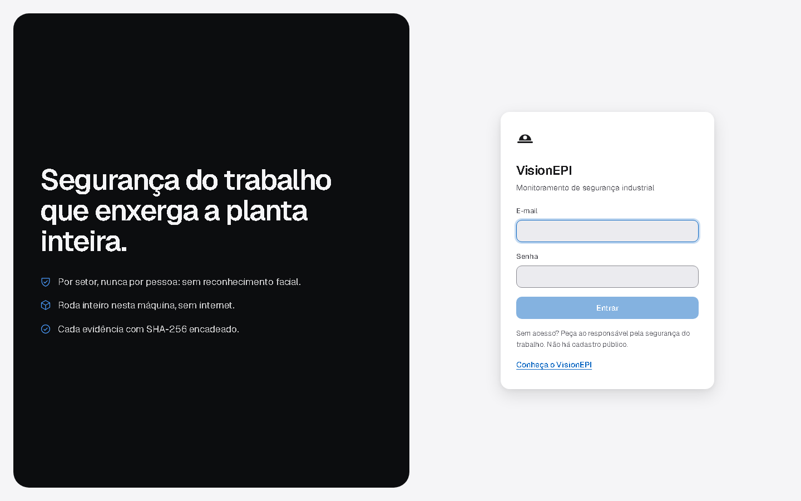

| Conta | O que vê |
|---|---|
| `supervisor@demo.local` | tudo: Início, câmeras, contas, Gestão (cadastra e edita), relatório mensal, Modo Apresentação |
| `tecnico@demo.local` | câmeras e configuração; Gestão (lê, registra entrega, devolução e ocorrência, exporta); **não cadastra colaborador nem item do catálogo** |
| `operador@demo.local` | só a câmera do setor dele, no quiosque; **a Gestão devolve acesso negado (403)** |

## 4. Início (visão geral do supervisor)

Depois do login o supervisor cai no **Início**: uma saudação, a frase "A planta agora, nesta máquina." e quatro números ao vivo: **câmeras no ar, pessoas na planta,
incidentes ativos e nível da planta**. Abaixo, a grade de atalhos: o cartão grande **Câmeras** (com miniaturas reais), **Apresentação**, **Gêmeo digital**, **Liga de Setores**,
**Cadeia de custódia**, **Simulador**, **Retrospectiva**, **Modo TV**, **Contas** e o cartão da **Gestão de EPIs**. Quando o primeiro acesso não foi concluído, um aviso
leva ao assistente; na demonstração ele já vem concluído.


Na tela de Câmeras o botão **Visão geral** mostra o painel por setor, o mesmo do Modo TV, com atalhos para as telas de tela cheia (Status do sistema, Gestão de EPIs,
Relatório mensal (CIPA), Portal de Entrada e outras).

## 5. Câmeras e foco: monitoramento em tempo real

1. Clique em **Câmeras**. A grade mostra as câmeras da demonstração: **Canteiro** (Obra), **Pátio** (Expedição), **Escada** (Manutenção) e **Portal** (Portaria). As três primeiras
   tocam gravações e vêm rotuladas **GRAVAÇÃO**; o Portal usa a webcam, se houver (rótulo **AO VIVO**), ou uma gravação.
2. Em cada cartão há o estado da câmera (por exemplo "recebendo", "aguardando frame", "fonte de demonstração") e a miniatura.
3. Se as câmeras estiverem paradas, use o botão **Iniciar** na barra superior (o vermelho **Parar** a desliga).

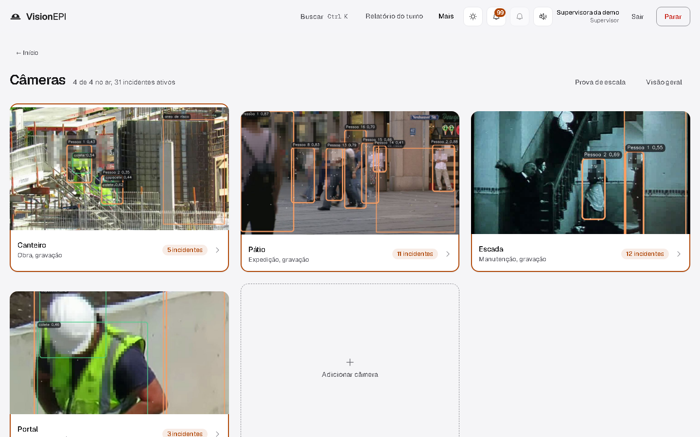

4. Clique numa câmera para abrir o **foco**. O vídeo traz as caixas de pessoa e de EPI desenhadas no navegador, o estado de cada EPI por pessoa (detectado, visto sem,
   não detectado ou indisponível) e abas ao lado: Alertas, Pessoas, Diagnóstico, Mapa de calor e Quedas e postura, entre outras.
5. A tecla **X** liga o **Raio-X**: o que o modelo viu (esqueleto, confiança por classe) separado do que o sistema decidiu.

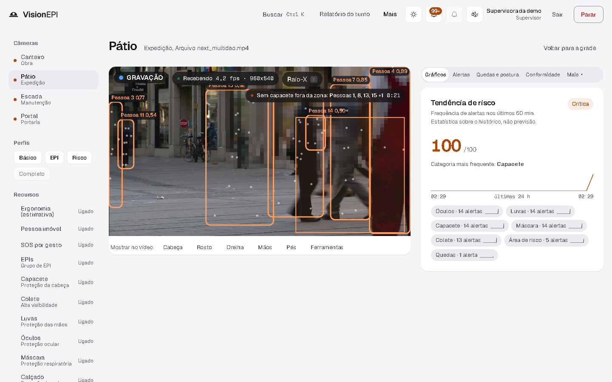

**O que esperar.** Os números dependem da máquina; na demo a análise por câmera é baixa quando as quatro câmeras competem. Isso é limitação conhecida
(`docs/arquitetura.md`, seção 7), não defeito da instalação.

## 6. Alertas e incidentes

- Na aba **Alertas** do foco, os alertas aparecem agrupados por pessoa (ID de rastreio, não identidade), com a regra, a câmera e a hora. Um alerta crítico toca um som curto;
  o botão de som na barra superior silencia.
- O sistema **agrupa alertas em incidentes** (mesma câmera, regra e zona). O cartão do incidente conta a linha causal só com o que foi registrado, e
  **Reconhecer** fecha o ciclo. O vídeo do incidente tem **replay** com rosto desfocado.
- **Cadeia de custódia** (atalho no Início, rota `/auditoria`): **Verificar integridade** confere a cadeia SHA-256 das evidências e aponta o elo quebrado se um byte mudou.
- Se existir a **segunda opinião** do LLM, ela aparece num campo separado, rotulada "Modo demonstração" quando não há chave. Ela **nunca cria nem apaga alerta**.

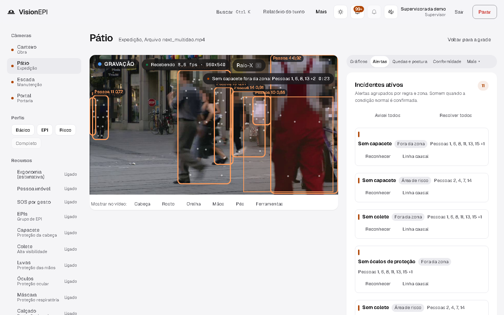

## 7. Gestão de EPIs

Módulo desta entrega. É um **cadastro administrativo**: a tela diz "não é ligado às câmeras", e nenhum dado aqui se liga a uma pessoa detectada pelo vídeo. Acesso:
barra superior, **Mais**, **Gestão de EPIs**; ou o cartão da Gestão no Início; ou direto em `/gestao`. Cada aba também abre por `/gestao?aba=entregas` (`colaboradores`, `catalogo`,
`entregas`, `ocorrencias`, `relatorios`).

Todos os dados desta demonstração são **simulados** (nomes fictícios, fabricantes fictícios, CAs fictícios na faixa 9xxxxx). A tela mostra o selo **Dados simulados**. Segundo o contrato
(`docs/specs/es-sprint4-contrato-gestao.md`), o seed traz 24 colaboradores, 10 itens de catálogo, cerca de 60 entregas, 15 ocorrências e 40 alertas históricos já resolvidos; confira as contagens
na aba Relatórios e exportação, porque os números exatos saem do seed.

### 7.1 Colaboradores

Aba **Colaboradores**: tabela com matrícula, nome, setor, função, **EPIs vigentes** e **pendências**, com busca e filtro por setor. O supervisor vê o botão **Novo colaborador** (matrícula única); o técnico, não.

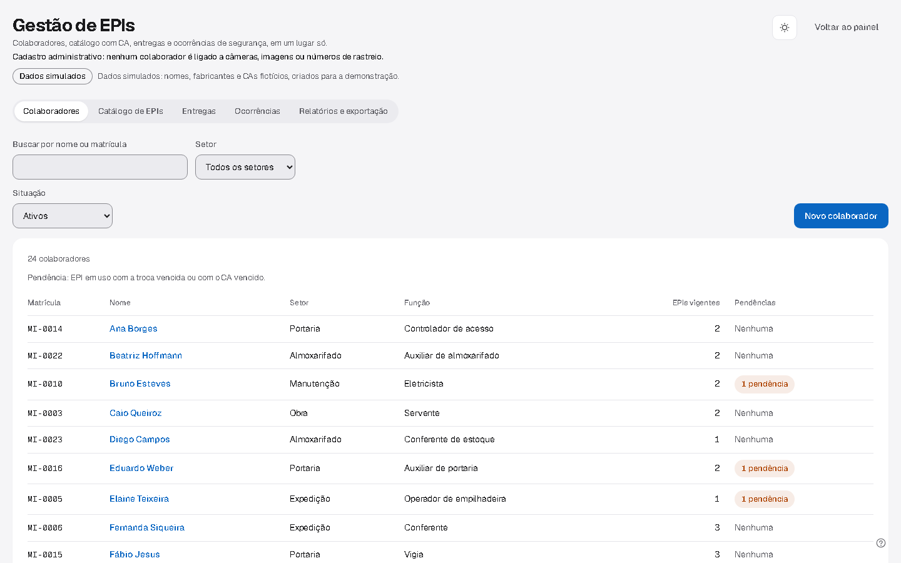

### 7.2 Histórico de EPIs de um colaborador

Clique no nome de um colaborador. A ficha mostra o **Histórico de EPIs**, do mais recente ao mais antigo (EPI, quantidade, data de entrega, **troca prevista**, data de devolução, motivo e
situação: vigente, troca vencida ou devolvido) e as **Ocorrências ligadas**. Há entregas devolvidas por substituição e entregas com troca vencida.


### 7.3 Catálogo de EPIs

Aba **Catálogo de EPIs**: cada item tem categoria, **CA**, **validade do CA**, fabricante e **vida útil**, com a situação do CA calculada pelo servidor (**válido**, **a vencer** em até 30 dias ou
**vencido**). Filtros por categoria e por situação do CA. Segundo o contrato, o seed deixa um CA vencido e dois a vencer. O supervisor vê **Novo item**.

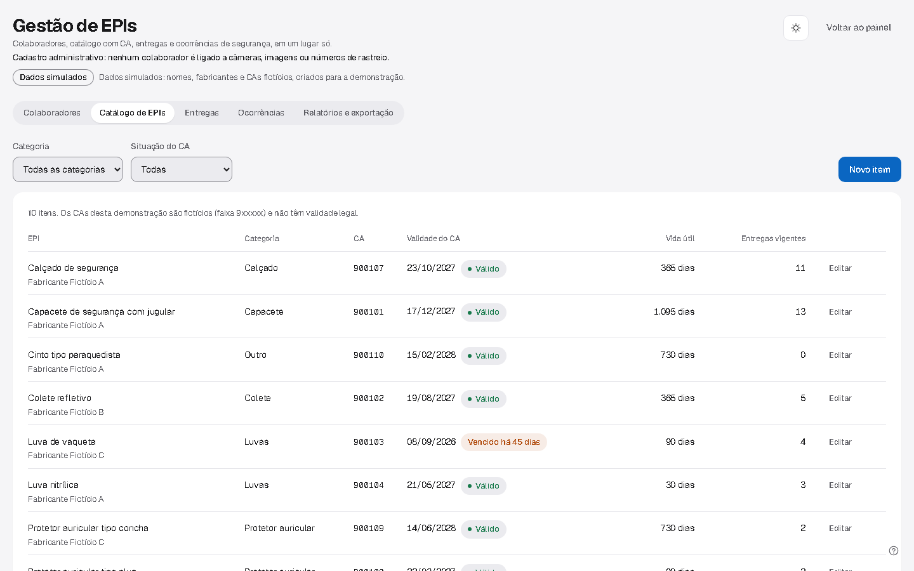

### 7.4 Entregas e devoluções

Aba **Entregas**: filtro por situação e botão **Registrar entrega** (colaborador, EPI, quantidade, data, motivo, observação). A **troca prevista** é a data da entrega mais a vida útil do item.
Em cada linha, **Registrar devolução**.

Dois testes rápidos das regras de negócio:

1. Tente registrar a entrega de um item cujo **CA está vencido**: o servidor recusa (HTTP 409, `ca_vencido`) e a tela mostra a mensagem. Essa trava é política da empresa, não texto literal da NR-6.
2. Registre a devolução de uma entrega já devolvida: recusa (409, `ja_devolvido`).

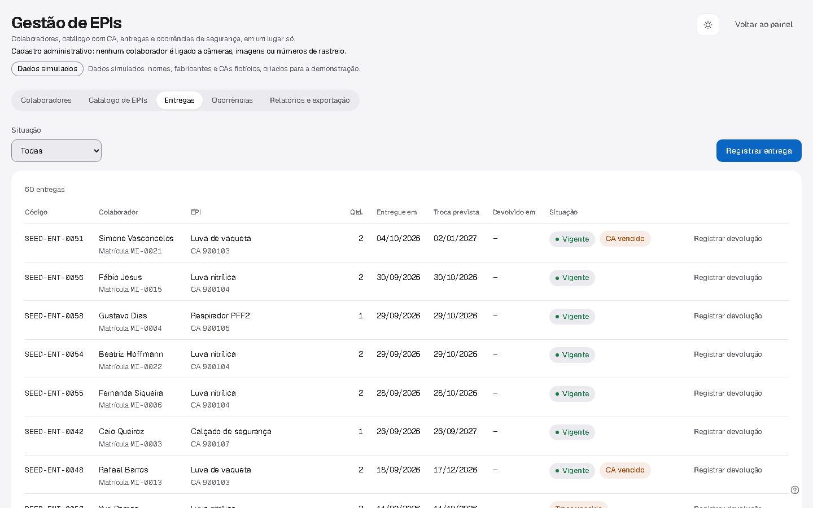

### 7.5 Ocorrências

Aba **Ocorrências**: lista com código, quando, tipo (acidente, quase acidente, condição insegura, ato inseguro), gravidade, setor, descrição, colaborador e status (aberta, em
tratamento, encerrada), com filtros por status, tipo e setor. **Registrar ocorrência** cria uma nova (o colaborador é opcional: **Sem colaborador ligado**). **Atualizar ocorrência**
muda o status e a ação corretiva; encerrar preenche a data de encerramento.

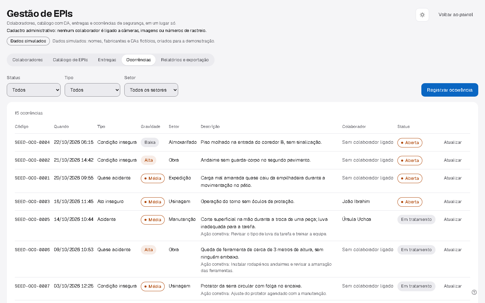

### 7.6 Exportar CSV

Aba **Relatórios e exportação**: um **Resumo** (colaboradores ativos, EPIs no catálogo, entregas vigentes, trocas vencidas, CAs vencidos e a vencer, ocorrências abertas e em 30 dias, alertas em
30 dias) e a seção **Exportar em CSV** com cinco arquivos: colaboradores, catálogo de EPIs, entregas, ocorrências e alertas. Cada **Baixar CSV** gera
`visionepi-<recurso>-<AAAA-MM-DD>.csv`, em UTF-8 com BOM e ponto e vírgula entre as colunas, que o Excel em português abre direto.

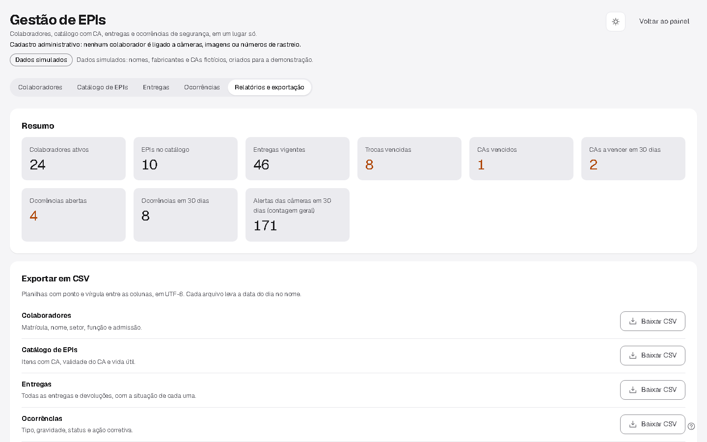

## 8. Relatório mensal

Na aba Relatórios e exportação, **Abrir o relatório mensal** (ou o atalho **Relatório mensal (CIPA)** na Visão geral). A página abre em outra aba, em `/relatorio/mensal`, e aceita `?mes=AAAA-MM`.
É o relatório para a CIPA, montado a partir do histórico do sistema. O **Relatório do turno** (barra superior) segue a NR-6.

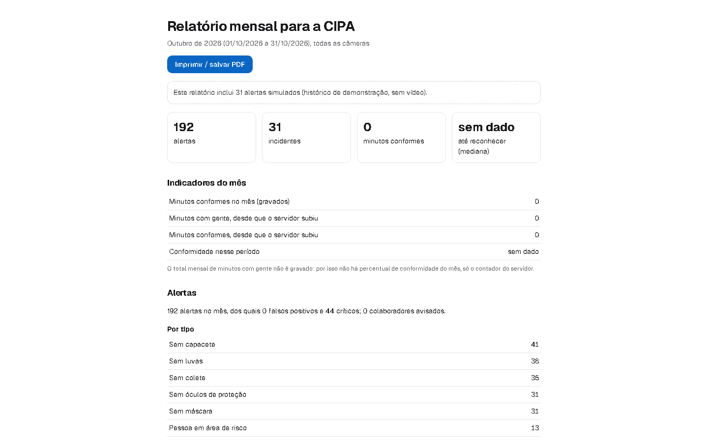

## 9. Segunda opinião do LLM e o modo demonstração

Sem `GEMINI_API_KEY`, a demonstração mostra uma resposta **fixa**, que não olha a imagem e diz isso. Dois lugares sinalizam:

- na tela de foco da câmera, em **Mais → Segunda opinião**, o chip **"Modo demonstração · resposta fixa, sem chave do Gemini"** (a resposta aparece depois que um alerta novo nasce naquela câmera);
- em **Status do sistema** (`/status`, técnico ou mais), o componente da segunda opinião diz "Modo demonstração: sem chave, a segunda opinião é uma resposta fixa, sem análise da imagem."

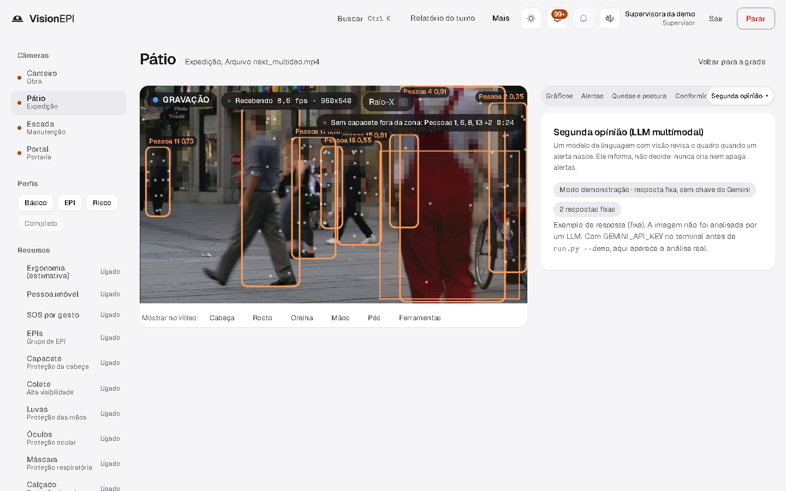

Para ver o Gemini real, exporte `GEMINI_API_KEY` no terminal **antes** de subir `run.py --demo`; a resposta passa a vir do modelo (latência de 16 a 38 s por chamada) e o chip some.
Fora da demo, sem chave, a camada fica desligada.

## 10. Modo Apresentação

No Início, o atalho **Apresentação** abre `/palco` (técnico ou mais). São 18 cenas: abertura com números da planta, Portal de Entrada, "Tente enganar a IA", Raio-X, Tape a câmera,
gêmeo digital, queda, evacuação, incidente e linha causal, cadeia de custódia, simulador, regra sem código, permissão com vigia, fábrica conectada, primeiro acesso, Liga, retrospectiva e encerramento.

- **Espaço** ou **seta para a direita** avança; **seta para a esquerda** volta; **Q** mostra ou esconde o QR do controle pelo celular; **X** liga o Raio-X.
- O controle pelo celular exige subir com `--https`. Sem ele, o teclado manda.
- Algumas cenas pausam as outras câmeras de propósito (o rodapé diz quais). A cena "Tape a câmera" só funciona com webcam.
- A queda toca a **0,25x**, e a tela diz "GRAVAÇÃO · 0,25x".

Roteiro completo e plano B por falha: `docs/NEXT2026/DEMO.md`.

## 11. Tema escuro

O botão de **tema** na barra superior troca entre claro e escuro. O claro é o padrão da demonstração; o escuro tem valores próprios, não é uma inversão.

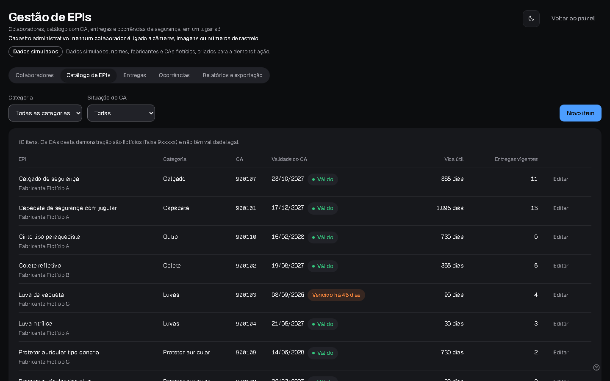

## 12. Reiniciar a demonstração e problemas comuns

| Situação | O que fazer |
|---|---|
| Quer voltar ao estado inicial sem reiniciar o servidor | Em **outro** terminal: `.venv\Scripts\python -m flask --app wsgi demo reset` (menos de 10 s). Limpa alertas, incidentes, eventos e custódia e recria os 40 alertas simulados; **mantém as contas** |
| "o banco da demo está em uso" ao subir | já há uma demo rodando; feche-a |
| "gravações ausentes em tests/fixtures" | só aparece se a amostra `amostras/canteiro_amostra.mp4` também faltar; rode `python scripts/fetch_fixtures.py` (uma vez, com internet) |
| "gravações não baixadas ... tocam a amostra versionada" | aviso, não erro: as câmeras listadas tocam a amostra de 7 s; para as gravações completas, `python scripts/fetch_fixtures.py` |
| Porta 5000 ocupada | PowerShell: `$env:PORT="5050"`; macOS/Linux: `PORT=5050 .venv/bin/python run.py --demo`; abra a porta nova |
| Esqueci a senha impressa | reinicie a demo: o banco é recriado e as senhas mudam |
| Câmeras sem análise por alguns segundos | a primeira análise e a troca de formato compilam o modelo; espere. Em máquina sem GPU Intel, o runtime cai para ONNX e fica mais lento |
| Webcam não abre | o Portal toca a gravação `portal.mp4`; siga |

## 13. Roteiro de aceite em 10 minutos

1. Subir a demonstração e anotar as senhas (seção 2).
2. Entrar como supervisor (seção 3).
3. No Início, conferir os quatro números ao vivo (seção 4).
4. Abrir a grade e uma câmera em foco; ligar o Raio-X com **X** (seção 5).
5. Ver um alerta e o incidente; rodar **Verificar integridade** na Cadeia de custódia (seção 6).
6. Abrir `/gestao`; abrir um colaborador e ler o histórico (seções 7.1 e 7.2).
7. No Catálogo, achar o CA vencido; tentar entregá-lo e ver a recusa (seções 7.3 e 7.4).
8. Registrar uma ocorrência e encerrá-la (seção 7.5).
9. Baixar o CSV de entregas e abrir numa planilha (seção 7.6).
10. Abrir o relatório mensal, o `/status` e trocar para o tema escuro (seções 8, 9 e 11).

Cada passo corresponde a um requisito de [requisitos.md](requisitos.md) (RF13, RF20, RF21, RF41 a RF45, RF32, RF37, RF40, RNF08).
